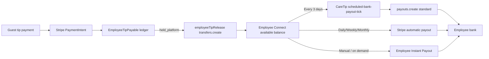

# CareTip — Employee Payout Schedule — Audit & Implementation Report

**Date:** 2026-09-28  
**Scope:** Employee bank payout schedule (parity with business product options)  
**Final status:** **READY FOR REVIEW**

---

## 1. Executive Summary

Fanny confirmed payout schedule is for **employees and businesses**. The codebase already separated:

1. **CareTip → employee Stripe Connect** (`transfers.create` via `employeeTipRelease.service.ts`) — tip routing, not bank schedule.
2. **Employee Stripe Connect → bank** (`payouts.create` standard/instant, Stripe automatic schedule on the **employee** connected account) — this is what the new feature controls.

Employee payout schedule was **missing**; business schedule existed. Implementation adds employee-owned schedule fields, API, UI, shared Stripe schedule sync, and extends the **existing** `scheduled-bank-payout-tick` cron path to process due **employees** (no second cron).

**Deploy requirement:** apply migration `20260928193000_employee_bank_payout_schedule` before employee scheduling runs in production.

---

## 2. Original Employee Payout Architecture

| Layer | Mechanism | CareTip role |
|-------|-----------|--------------|
| Tip payable ledger | `EmployeeTipPayable` | Records held / transferring / transferred |
| Platform → Connect | `employeeTipRelease.service.ts` (`transfers.create`) | Event-driven when account ready |
| Connect balance | Stripe Balance (`available` / `pending`) | Stripe settlement |
| Connect → bank | Stripe `payouts` (standard auto, manual + CareTip cron, or instant) | Schedule + observation |
| Observation | `EmployeeStripePayout`, webhooks | Reconciliation / UI history |

Employees use **Express recipient** accounts (`EmployeeStripeAccount`, `stripe_transfers` capability), not business merchant accounts.

---

## 3. Employee Money Flow

**Distinct concepts (not interchangeable):**

- **Pending vs available** — Stripe settlement; only **available** is payout-eligible.
- **CareTip transfer** — Moves tip value to the employee Connect account.
- **Bank payout** — Stripe moves Connect **available** balance to the external bank account.
- **Payout schedule** — Controls **bank payout cadence** on the Connect account, not tip release timing.

There is **no** CareTip 7-day hold in this architecture.

---

## 4. Business vs Employee Payout Architecture

| Aspect | Business | Employee |
|--------|----------|----------|
| Connect model | Express merchant (`Business.stripeAccountId`) | Express recipient (`EmployeeStripeAccount`) |
| Tips in | Business Connect (or distribution) | Transfer to employee Connect (direct mode) |
| Schedule storage | `Business.bankPayoutSchedule` | `EmployeeStripeAccount.bankPayoutSchedule` |
| Next due (every_3_days) | `Business.bankPayoutNextScheduledAt` | `EmployeeStripeAccount.bankPayoutNextScheduledAt` |
| Timezone for 09:00 | `Business.timezone` | Employer `Business.timezone` (employee has no separate TZ field) |
| Scheduled ledger | `stripe_connect_scheduled_payout_requests` | `employee_stripe_scheduled_payout_requests` |
| Idempotency prefix | `caretip_scheduled_payout:{businessId}:…` | `caretip_employee_scheduled_payout:{employeeId}:…` |
| API | `GET/PATCH /api/me/connect/bank-payout-schedule` | `GET/PATCH /api/me/employee-connect/bank-payout-schedule` |
| Cron | Same `scheduled-bank-payout-tick` | Same tick (`employee` counts in response) |

---

## 5. Audit Findings

- Employee Connect UI (`EmployeePaymentsConnectPage`) had instant payout, bank history, and account card — **no** schedule control.
- `employeeStripeBankPayouts.service.ts` lists Stripe bank payouts (read-only); copy correctly states CareTip records **transfers**, not bank payouts.
- `employeeTipRelease` must remain event-driven; **not** modified.
- Business distribution mode: tips may not route to employee Connect; schedule UI hidden when `employeeTipPayoutMode === business_distribution` (same pattern as instant payout visibility).
- Stripe does not support `every_3_days` interval — manual + CareTip scheduler (same as business).

---

## 6. Root Causes / Gaps

- Product intent included employees; implementation was business-only.
- Employee bank cadence was implicitly “whatever Stripe default is” with no CareTip preference or every-3-days orchestration.

---

## 7. Implementation Performed

- Shared Stripe schedule sync: `connectBankPayoutSchedule.core.ts` (used by business + employee).
- Employee schedule service: `employeeBankPayoutSchedule.service.ts`.
- Employee scheduler: `employeeScheduledBankPayout.service.ts` (P2002-safe ledger, same semantics as business).
- Extended `tickScheduledBankPayouts()` to run business + employee batches (aggregated + `business` / `employee` breakdown).
- Employee API + UI + EN/DE i18n.
- Runtime test script: `employee-bank-payout-schedule-runtime.ts`.

---

## 8. Database Changes

**Migration:** `backend/prisma/migrations/20260928193000_employee_bank_payout_schedule/migration.sql`

- `employee_stripe_accounts.bank_payout_schedule` (`BusinessBankPayoutSchedule`, default `daily`)
- `employee_stripe_accounts.bank_payout_next_scheduled_at`
- Table `employee_stripe_scheduled_payout_requests` (unique `(employee_id, schedule_window_key)`, unique `idempotency_key`)

---

## 9. API Changes

| Method | Path | Auth |
|--------|------|------|
| GET | `/api/me/employee-connect/bank-payout-schedule` | Employee JWT |
| PATCH | `/api/me/employee-connect/bank-payout-schedule` | Employee JWT, body `{ schedule }` only |

Ownership from `resolveActiveEmployeeForConnect(userId)` — no client employee/stripe IDs.

---

## 10. Scheduler Changes

- **No new cron.** Existing `POST /api/internal/jobs/scheduled-bank-payout-tick` calls `tickScheduledBankPayouts()`, which now includes `tickEmployeeScheduledBankPayouts()` (up to 50 due employees per tick).
- Response shape adds `business` and `employee` objects; top-level counts are **sums**.

---

## 11. Stripe Integration

- Schedule preference → `accounts.update` `settings.payouts.schedule` on the **employee** `acct_…` (via shared core).
- `every_3_days` / `manual` → `interval: manual`; CareTip `payouts.create` (standard, available balance only).
- Does **not** use `transfers.create` for bank payouts or instant for scheduled runs.

---

## 12. UI Changes

- `EmployeeBankPayoutScheduleCard` on `EmployeePaymentsConnectPage` (rail), hidden in business distribution mode.
- Responsive pill radio pattern (matches business card): flex-col on narrow viewports, wrap on `sm+`.

**Mobile app:** `mobile/features/employee/payouts/EmployeePaymentsConnectScreen.tsx` was **not** updated in this pass (web employee dashboard only). Add mobile parity in a follow-up if required.

---

## 13. Security / Authorization Review

- Schedule read/write uses `resolveActiveEmployeeForConnect` (active employee, verified user, business not closed/legal hold).
- `rejectClientEmployeeConnectSteering` on PATCH (same family as other employee Connect routes).
- Manager business schedule routes unchanged.
- No client-supplied `stripeAccountId` / `employeeId` on schedule endpoints.

---

## 14. i18n Review

- `employee.payouts.schedule.*` in `en.json` and `de.json` (title, lead, speedNote, **transferNote**, options, errors, next payout).

---

## 15. Mobile Responsiveness Review (web)

- Schedule card uses `min-w-0`, full-width stacked options on mobile, `min-h-10` touch targets, no horizontal scroll in the card itself.
- Verified structurally against existing payout workspace classes (`caretip-payout-layout`, `caretip-payout-rail`).

---

## 16. Tests Executed

| Command | Result |
|---------|--------|
| `cd backend && npx tsc` | **PASS** |
| `cd backend && npm run test:business-bank-payout-schedule` | **PASS** |
| `cd backend && npm run test:employee-bank-payout-schedule` | **PASS** |
| `cd backend && npm run test:business-scheduled-bank-payout` | **PASS** (business tick only in multi-business case; employee DB columns not required for that script) |
| `cd .. && npm run typecheck` | **PASS** |
| `cd backend && npm run build` | **Not run to completion** — `prisma generate` EPERM (local query engine locked, likely dev server). `tsc` passes. |

**Not run:** Full frontend `npm run build`, Playwright, employee transfer recovery integration suite, live Stripe sandbox E2E.

---

## 17. Test Results

All executed runtime scripts above exited **0**. Business scheduled DB tests continue to validate P2002 handling, idempotency, failure/non-advance, and zero-balance behavior on **business** paths.

---

## 18. Files Changed (principal)

**Backend:** `connectBankPayoutSchedule.core.ts`, `businessBankPayoutSchedule.service.ts`, `businessScheduledBankPayout.service.ts`, `employeeBankPayoutSchedule.service.ts`, `employeeScheduledBankPayout.service.ts`, `employeeConnect.controller.ts`, `employeeConnect.routes.ts`, `schema.prisma`, migration SQL, runtime scripts, `package.json` scripts.

**Frontend:** `EmployeeBankPayoutScheduleCard.tsx`, `EmployeePaymentsConnectPage.tsx`, `api.ts`, `en.json`, `de.json`.

**Docs:** this report.

---

## 19. Files Not Changed and Why

| Area | Reason |
|------|--------|
| `employeeTipRelease.service.ts` | Transfer/release must stay event-driven |
| `employeeTipPayable.service.ts` | Payable math unchanged |
| `stripeConnectInstantPayout.service.ts` / employee instant | Instant path separate |
| Business schedule services behavior | Preserved; only shared Stripe sync extracted |
| Webhooks / reconciliation services | Scheduled payouts still ingested via existing persist paths |
| `render.yaml` / cron | No infra changes in repo |
| Mobile Connect screen | Out of scope for this web implementation pass |

---

## 20. Regression Verification

- Business schedule static + scheduled runtime tests **pass**.
- Employee scheduler does not import tip release.
- Combined tick preserves business loop + adds isolated employee loop with per-employee serialization keys.
- Business distribution hides employee schedule UI (no misleading bank schedule when tips are business-routed).

---

## 21. Risks / Limitations

1. **Migration required** before employee tick runs against production DB.
2. **Mobile native** employee UI lacks schedule card until ported.
3. **Combined tick** runs employee queries even when no employees on `every_3_days` (cheap indexed query).
4. **Timezone** uses employer business timezone — document for support if employees work across regions.
5. **Manual** mode: employee may still use Instant Payout; no CareTip automatic standard payout.

---

## 22. Deployment Requirements

1. Deploy backend + frontend builds.
2. Run migration `20260928193000_employee_bank_payout_schedule`.
3. Existing Render cron `caretip-scheduled-bank-payout-tick` automatically includes employees once migrated (see `CARETIP_SCHEDULED_BANK_PAYOUT_CRON_SETUP.md`).

---

## 23. Final Verification Checklist

- [x] Employee schedule persisted on `employee_stripe_accounts`
- [x] GET/PATCH employee endpoints scoped to authenticated employee
- [x] Stripe mapping via server-resolved `EmployeeStripeAccount.stripeAccountId`
- [x] Daily/weekly/monthly → Stripe automatic; every_3_days → manual + CareTip; manual → no CareTip auto standard payout
- [x] Available balance only for scheduled create
- [x] No 7-day CareTip hold introduced
- [x] Single cron extended (not duplicated)
- [x] Idempotency + P2002 handling on employee ledger
- [x] Business scheduling regression tests pass
- [x] EN/DE strings
- [ ] Mobile app schedule UI (follow-up)
- [ ] Production migration applied in target environment

---

## 24. Final Status

# READY FOR REVIEW

Apply the employee migration and verify one employee `every_3_days` path in staging before production promotion.
