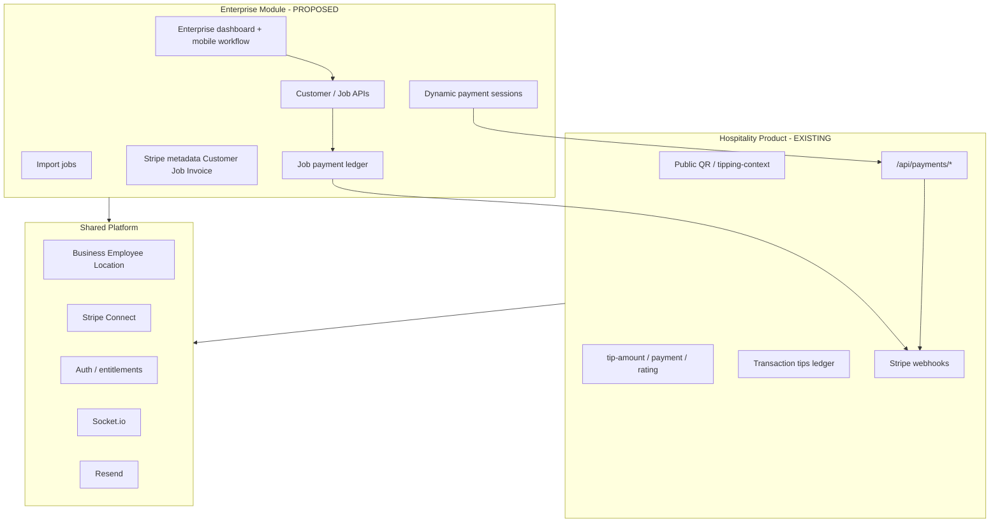

# CareTip Enterprise Field-Service Module — Implementation Forensic Audit

**Status:** READ-ONLY pre-implementation audit (no code changes).  
**Source document:** `template/Updates 26.09.pdf` (present on disk; **verbatim PDF text not machine-extracted in this audit run** — requirements below are taken from that document as summarized in the audit brief and cross-checked against `CARETIP_ALBERTINA_PART_A_IMPLEMENTATION_REPORT.md` Enterprise “on hold” scope).  
**Repository evidence date:** 2026-09-26 (security-by-design addendum: 2026-09-27).  
**Enterprise hospitality tipping (Part A):** separate; not in scope here.

**Document structure:** §§1–29 and appendices = original forensic audit. **Part II (§30+)** = security-by-design implementation specification (read-only; no code changes).

---

## 1. Source of truth — Enterprise requirements (from Albertina document)

The following capabilities are **in scope for Enterprise** per the uploaded requirements. Do not treat this list as exhaustive legal specification; confirm against the PDF before contracting.

| # | Requirement (as stated) |
|---|-------------------------|
| 1 | **Customer profiles** — store and manage end-customers of the Enterprise client |
| 2 | **Job / task creation and assignment** — work units tied to customers, assignable to employees |
| 3 | **Bulk CSV/Excel import** — onboard customers/jobs (and related data) at scale |
| 4 | **Employee status tracking** — e.g. En route → On site / Started → Job completed |
| 5 | **Real-time employee/job visibility** — dispatchers/managers see live state |
| 6 | **Dynamic Direct Pay** — pay a **job/invoice amount**, not a discretionary tip |
| 7 | **Dynamic QR payment** — QR encodes or resolves a **specific payable** (amount/session), not only static staff QR |
| 8 | **Payment methods** — Apple Pay / card / **Klarna where supported** (document ask) |
| 9 | **Stripe Tap to Pay** — investigate / support in-person card present (document ask) |
| 10 | **Stripe metadata** — `Customer_ID`, `Employee_ID`, `Job_ID`, `Invoice_Ref` |
| 11 | **Payment status synchronization** — UI and back office reflect Stripe truth |
| 12 | **Automated payment receipts** — customer-facing confirmation (document; VAT nuance) |
| 13 | **VAT breakdown** — on receipts/invoices (document ask) |
| 14 | **Reuse Stripe Connect** — existing business/employee Connect and routing |
| 15 | **Reuse QR routing** — existing slug/location/employee entry patterns where safe |
| 16 | **Isolated / white-label Enterprise module** — must not destabilize core hospitality product |
| 17 | **Responsive mobile web / PWA or lightweight wrapper** — avoid full native app if possible |

**TECHNICAL REQUIREMENT IDENTIFIED DURING AUDIT** (not necessarily spelled out in PDF but required to implement safely):

- **Signed, short-lived payment session tokens** for dynamic QR (amount integrity, replay resistance).
- **Idempotent payment + webhook reconciliation** keyed on Stripe object IDs and internal job/payment IDs.
- **Tenant-scoped authorization** on every customer/job/payment API (Business isolation).
- **Async import job queue** with row-level error reporting (CSV at scale cannot run synchronously in HTTP).
- **Explicit product/module flag** on `Business` (or equivalent) so Enterprise UI and APIs do not leak into hospitality tenants.

---

## 2. Executive summary

### What are we being asked to build?

A **field-service operations and invoice-linked payments module** sitting on CareTip’s existing **multi-tenant SaaS**, **Stripe Connect**, **QR entry**, and **employee** infrastructure. It is **not** “tips with extra metadata.” It is **customer + job lifecycle + status + import + fixed (or constrained) amount payments + reconciliation + receipts**, optionally **in-person Tap to Pay**, delivered as a **separately branded / isolated** experience.

### Tipping product vs separate module?

**Architecturally:** still one platform (shared auth, Business, Employee, Stripe Connect, deployment). **Product-wise:** Enterprise is a **second commercial module** with different payment semantics (invoice/job amount, VAT, customer PII, job state). CareTip today is **fundamentally a discretionary tip ledger** (`Transaction` / `tips` table, Checkout for variable tip amounts).

### Reuse vs build

| Reuse (high confidence) | Build (required) |
|-------------------------|------------------|
| `Business`, `Employee`, `Location`, auth, roles | `Customer`, `Job`, `Invoice`/`Payable` entities |
| Stripe Connect onboarding (`/api/me/connect/*`, employee Connect) | Job status machine + APIs |
| Webhook idempotency (`StripeWebhookEvent`) | Import pipeline + UI |
| Guest Checkout pattern (`createTipCheckoutSession`) as **template** | Enterprise Checkout/PI with **fixed amount** + metadata |
| QR scan funnel (`/api/qr/scan`, `QrFunnelEvent`) | Dynamic payment session + signed QR payload |
| Resend email + `i18nEmail.ts` layout | VAT-grade document generation (**REQUIRES BUSINESS/LEGAL DECISION**) |
| Socket.io `tip.received` pattern | Job/employee status realtime events |
| `FeatureGate` / `subscriptionCapabilities.ts` | `enterpriseFieldService` capability + route namespace |
| Expo mobile app (API client, push, socket) | Tap to Pay (**native Stripe Terminal** — not in repo) |
| PWA (vite-plugin-pwa) | Enterprise white-label shell / branding dimension |

### Largest risks (concrete)

| Area | Risk |
|------|------|
| **Architecture** | Forcing Enterprise payments into `Transaction` (tips) without a parallel **JobPayment** model will break reporting, refunds, VAT, and hospitality analytics. |
| **Stripe** | **Merchant of record**, Connect destination, and **application fee** rules for B2B service invoices vs tips — **REQUIRES BUSINESS/LEGAL DECISION**. Klarna on Connect Checkout is **REQUIRES EXTERNAL VERIFICATION** (account country, MCC, Stripe Dashboard). |
| **Mobile / Tap to Pay** | **No Stripe Terminal / Tap to Pay code in repo.** Tap to Pay requires **native iOS/Android** (Stripe Terminal SDK). **REQUIRES EXTERNAL VERIFICATION** against [Stripe Terminal Tap to Pay](https://docs.stripe.com/terminal/payments/setup-reader/tap-to-pay) — not available in normal mobile browser/PWA alone. |
| **Data / security** | Bulk import + customer PII + IDOR on job/payment IDs; QR session tampering to pay wrong amount. |
| **Scope / maintenance** | White-label + realtime + import + payments + VAT + Tap to Pay is **multiple products**; `enterprise` tier today equals `premium` capabilities only (`subscriptionCapabilities.ts`) — no module boundary yet. |

### Must be decided before development

1. Merchant of record and who issues VAT invoice (**REQUIRES BUSINESS/LEGAL DECISION**).  
2. Whether Enterprise payments are **separate ledger** from `Transaction` (tips).  
3. Amount editability, partial payments, multi-payment per job.  
4. Tap to Pay: iOS only, Android only, or both; native wrapper acceptable?  
5. White-label: subdomain, theme only, or separate app ID?  
6. Countries/currencies (today tips are **EUR-only** enforced in `stripe.service.ts`).  
7. Klarna mandatory or optional?  

---

## 3. Existing CareTip architecture map

### 3.1 Frontend (`src/`)

| Layer | Evidence |
|-------|----------|
| **Framework** | React + Vite; router in `src/app/routes.tsx` (`createBrowserRouter`) |
| **Route shells** | Public marketing; `ProtectedRoute` business (`/dashboard/*`); employee (`/employee/*`); `PlatformAdminRoute` (`/platform-admin/*`); public customer tip flow |
| **State** | React context (auth, tip flow, branding); TanStack Query patterns in dashboards (inferred from mobile bridge) |
| **API** | `src/app/lib/api.ts` — centralized `apiRequest`, CSRF/client headers |
| **Auth** | Cookie/session + refresh (`/api/auth/refresh`); roles `MANAGER`, `EMPLOYEE`, platform admin |
| **i18n** | `react-i18next`, `src/i18n/locales/en.json`, `de.json` |
| **PWA** | `vite-plugin-pwa` in `vite.config.ts`; `deferredStartup.ts` registers SW |
| **Entitlements UI** | `FeatureGate.tsx`, `useSubscriptionEntitlements` |

**Where Enterprise fits:** New route subtree (e.g. `/dashboard/enterprise/*` or `/enterprise/*`) behind **new capability flag**, reusing `BusinessLayout` patterns but **not** guest tip pages (`/tip-amount`, `/payment`).

### 3.2 Backend (`backend/src/`)

| Layer | Evidence |
|-------|----------|
| **Server** | Express `index.ts` — mounts `/api/*`, raw Stripe webhooks `/api/webhooks/stripe` |
| **Pattern** | `routes/*.ts` → `controllers/*.ts` → `services/*.ts`; Prisma |
| **Auth** | `authMiddleware`, `requireVerifiedEmail`, `requireRole`, `requireCompletedOnboarding` |
| **Tenant isolation** | Business-scoped queries via `businessId` on managers; employee scoped to `employeeId` |
| **Jobs (async)** | `internalJobs.routes.ts` — cron-secret POST ticks (DSAR, retention, reconciliation) — **not** field-service jobs |
| **Email** | Resend (`resendClient.ts`), `i18nEmail.ts` |
| **Realtime** | Socket.io `initSocketServer`, `emitTip.ts`, `GET /api/socket/public-room-token` |

### 3.3 Database (Prisma)

- **48 models** in `backend/prisma/schema.prisma` (see §7).  
- **Tips** = `Transaction` mapped to `tips` table.  
- **No** `Customer`, `Job`, `Invoice`, `Client` models.  
- **Tenant root:** `Business` → `Employee`, `Location`, `Table`, `Transaction`, etc.  
- **Audit:** `AuditLog`, `BusinessActivityEvent` (projection SSOT for activity feed).  
- **Webhooks:** `StripeWebhookEvent` dedupe.

### 3.4 Infrastructure (from code + README patterns)

| Component | Usage |
|-----------|--------|
| **Postgres** | Prisma / Supabase pooler (env `DATABASE_URL`) |
| **Stripe** | Guest tips, SaaS billing, physical QR orders, Connect payouts |
| **Storage** | KYC uploads `uploads/kyc/`; Supabase storage helpers for avatars |
| **Email** | Resend (`RESEND_API_KEY`, `RESEND_FROM`) |
| **Deploy** | Frontend static + API (Render-style per README); cron hits `/api/internal/jobs/*` |

### 3.5 Architecture diagram (logical)



---

## 4. Existing API / route inventory

Full mount table is derived from `backend/src/index.ts` and `backend/src/routes/*.ts`. Below: **grouped summary** of routes **relevant** to Enterprise (not every marketing/legal route).

### AUTH — `/api/auth/*`

| Method | Path | Auth | Relevance |
|--------|------|------|-----------|
| POST | `/api/auth/register`, `/login`, `/oauth`, … | Public / mixed | Reuse for Enterprise users (same User model) |
| POST | `/api/auth/mobile-web-handoff/consume` | Public | Reuse for mobile wrapper handoff |
| PATCH | `/api/auth/me` | Auth | Locale/preferences |

### BUSINESS — `/api/business/*`

| Method | Path | Handler area | Reuse |
|--------|------|--------------|-------|
| GET/PATCH | `/api/business/profile`, branding, logo | `business.controller` | **Extend** for Enterprise branding dimension |
| GET | `/api/business/:businessId` | Public profile | Maybe **extend** cautiously (no PII) |
| GET | `/api/business/activity` | Activity feed | **Extend** projection for job events |
| POST | `/api/business/generate-invite` | Invites | Reuse pattern for Enterprise staff |

### EMPLOYEE — `/api/employees/*`

| Method | Path | Auth | Reuse |
|--------|------|------|-------|
| GET/PATCH | `/api/employees/me` | Employee | **Extend** with job assignment context |
| PATCH | `/api/employees/:employeeId` | Manager | Status today ≠ job routing status |
| GET | `/api/employees/:employeeId` | Public | Guest tip context only |

### LOCATION / TABLE — `/api/locations/*`, `/api/tables/*`

| Method | Path | Reuse |
|--------|------|-------|
| CRUD | locations, tables | Venue for hospitality QR; **partial** for Enterprise if jobs are address-based not location-table based |

### QR / TIPPING CONTEXT — `/api/tipping-context/*`, `/api/qr/scan`

| Method | Path | Auth | Stripe | Reuse |
|--------|------|------|--------|-------|
| GET | `/api/tipping-context/:qrSlug` | Public | No | **Pattern** for resolving context; Enterprise needs **payment session** not only employee slug |
| POST | `/api/qr/scan` | Public | No | **Extend** scan types for Enterprise funnel analytics |

### TIPPING / PAYMENTS — `/api/payments/*`, `/api/tips/*`

| Method | Path | Auth | DB | Stripe |
|--------|------|------|-----|--------|
| POST | `/api/payments/create-tip-session` | Public | Pre-checkout | Checkout Session **variable** amount |
| GET | `/api/payments/tip-session/:sessionId` | Public | `Transaction` | Session retrieve |
| GET | `/api/tips/business`, `/api/tips/employee` | Manager/Employee | `Transaction` | No |

**Enterprise:** Do **not** overload `create-tip-session` without strict `productType` guard — different compliance and amount rules.

### STRIPE CONNECT — `/api/me/connect/*`, `/api/me/employee-connect/*`

| Method | Path | Reuse |
|--------|------|-------|
| GET/POST | Connect status, account-link, payouts, tip-distribution | **Reuse** settlement rails; metadata and charge description differ for job pay |

### WEBHOOKS — `POST /api/webhooks/stripe`

| Event types (tip-related) | Handler |
|---------------------------|---------|
| `checkout.session.completed` | `handleSuccessfulTipPayment` (tips) |
| `payment_intent.succeeded` | `handlePaymentSuccess` (pending tips) |
| + billing, physical QR, Connect, refunds | Separate services |

**Enterprise:** New handler branch or service with **metadata discriminator** (`caretipProduct=enterprise_job_pay`).

### NOTIFICATIONS / REALTIME

| Method | Path | Reuse |
|--------|------|-------|
| GET/PATCH | `/api/me/notifications/*` | In-app inbox |
| Socket | `tip.received` via `emitTip.ts` | **Pattern** for `job.status_updated`, `job.payment_received` |

### FILES / EXPORT

| Method | Path | Reuse |
|--------|------|-------|
| GET | `/api/transactions/export` | CSV export pattern (json2csv) — **not** import |
| POST | `/api/me/export` | Async DSAR job pattern for **import** job queue |
| Multer | KYC, avatars, platform logo | Upload infra for import files |

### ADMIN / PLATFORM — `/api/platform/*`

Full platform CRUD — **not** Enterprise tenant admin; reuse audit patterns only.

### OTHER

| Path | Note |
|------|------|
| `/api/internal/jobs/*` | Cron workers — model for `enterprise-import-tick` |
| `/api/feedback/tip` | Hospitality feedback — separate from Google/TripAdvisor external reviews |

**Complete route list:** See forensic agent inventory (31 route modules); **NOT VERIFIED IN CODEBASE** line-by-line in this document for every handler signature — verify in repo before implementation.

---

## 5. Required new API / routing design (conceptual)

### A. EXISTING ROUTE CAN BE REUSED (with guards)

| Route | Guard / note |
|-------|----------------|
| `/api/auth/*` | Same identity |
| `/api/me/connect/*`, `/api/me/employee-connect/*` | Same Connect accounts |
| `/api/qr/scan` | Add `scanType: enterprise_job_payment` |
| `/api/me/notifications/*` | New notification types |
| Socket public room token | Enterprise rooms `business:{id}:jobs` |

### B. EXISTING ROUTE NEEDS EXTENSION

| Route | Extension |
|-------|-----------|
| `GET /api/business/profile` | `products: { hospitality: true, enterprise: true }` |
| `subscriptionCapabilities` | New capabilities: `enterpriseJobs`, `enterpriseImport`, … |
| Stripe webhook router | Branch on session/PI metadata |

### C. NEW ROUTE REQUIRED (proposed)

| Method | Path | Purpose | Auth |
|--------|------|---------|------|
| GET/POST/PATCH/DELETE | `/api/enterprise/customers` | Customer CRUD | Manager |
| GET/POST/PATCH | `/api/enterprise/jobs` | Job CRUD + assign | Manager |
| POST | `/api/enterprise/jobs/:id/status` | Employee status transitions | Employee (assigned) |
| GET | `/api/enterprise/jobs/:id` | Job detail + payment state | Manager / assigned Employee |
| POST | `/api/enterprise/imports` | Upload CSV/XLSX | Manager |
| GET | `/api/enterprise/imports/:jobId` | Import status + errors | Manager |
| POST | `/api/enterprise/payments/create-session` | Dynamic Checkout for job amount | Public (token) or Manager-generated link |
| GET | `/api/enterprise/payments/session/:id` | Poll payment status | Public (scoped token) |
| POST | `/api/enterprise/jobs/:id/qr` | Issue signed dynamic QR session | Manager / Employee |
| GET | `/api/enterprise/employees/live` | Dispatcher map/list | Manager |

**Idempotency:** `Idempotency-Key` header on payment session create; DB unique on `(businessId, jobId, paymentIntentId)`; import `importBatchId`.

### D. REQUIREMENT CANNOT YET BE CONFIRMED

- Klarna payment method on Connect Checkout for Enterprise (**REQUIRES EXTERNAL VERIFICATION**).  
- Tap to Pay API surface (**REQUIRES EXTERNAL VERIFICATION** + native app decision).  
- VAT-compliant PDF format (**REQUIRES BUSINESS/LEGAL DECISION**).

---

## 6. Frontend routing audit

### Existing routes potentially reusable

| Route | Use for Enterprise |
|-------|-------------------|
| `/dashboard/*` shell | Host Enterprise sub-routes |
| `/employee/*` | Mobile technician workflow (new pages) |
| `/mobile-auth` | Wrapper handoff |
| Public `/payment`, `/success` | **Avoid reuse** — tip-specific UX; clone pattern as `/enterprise/pay/:token` |

### Options (evidence-based comparison)

| Option | Pros | Cons |
|--------|------|------|
| `/dashboard/enterprise/*` | Same auth gate as business; clear nesting | Risk of UI coupling to hospitality nav |
| `/enterprise/*` top-level | Strong separation | Needs duplicate guards or wrapper |
| `/field-service/*` marketing + app | Matches industry page | Conflicts with `/industries/field-service` marketing only today |

**Recommendation (pre-Phase-1):** **`/dashboard/enterprise/*`** for manager/dispatcher + **`/employee/jobs/*`** (or `/employee/field/*`) for technicians, gated by `requireFeature(enterpriseFieldService)` (name TBD). **Do not** reuse `TipFlowContext` for job payments.

### ROUTES THAT SHOULD NOT BE REUSED

- `POST /api/payments/create-tip-session` response handling in `TipAmountPage` / variable amount UX.  
- `Transaction`-centric success screens without job context.  
- Hospitality `FeatureGate` pages mixed into Enterprise without capability split.

---

## 7. Customer & job management — data model gap

### Current state

| Concept | In codebase? |
|---------|----------------|
| Customer (B2C of Enterprise client) | **No** |
| Job / task | **No** (`DataLifecycleJob` is compliance async only) |
| Invoice | **No** (Stripe billing subscription invoices ≠ service invoice) |
| Service appointment | **No** |
| Employee assignment | **Partial** — `Employee.locationId`, `EmployeeTableAssignment` (hospitality tables) |
| Address on job | **No** (Location is venue, not customer address) |
| Payment status on job | **No** |

### Proposed entities (conceptual — not implemented)

**EnterpriseCustomer**

- `id`, `businessId`, `externalRef?`, `name`, `email?`, `phone?`, `billingAddress?`, `metadata`, `createdAt`, `updatedAt`, `deletedAt?`  
- Indexes: `(businessId, email)`, `(businessId, externalRef)` unique where not null  
- Isolation: **every query** `where: { businessId: ctx.businessId }`

**EnterpriseJob**

- `id`, `businessId`, `customerId`, `assignedEmployeeId?`, `status`, `title`, `description?`, `scheduledAt?`, `address?`, `amountCents`, `currency` (default EUR), `invoiceRef?`, `paymentStatus`, `paidAt?`, `metadata`  
- Indexes: `(businessId, status, scheduledAt)`, `(assignedEmployeeId, status)`  
- Lifecycle: soft-delete or cancel with retention policy **REQUIRES BUSINESS/LEGAL DECISION**

**EnterpriseJobPayment** (recommended **separate from `Transaction`**)

- Links `jobId`, `stripePaymentIntentId`, `stripeCheckoutSessionId?`, `amount`, `status`, `receiptNumber?`, `guestConfirmationEmailSentAt?` (pattern from tips)  
- Avoid conflating hospitality tip analytics with B2B job revenue.

**EnterpriseImportBatch / EnterpriseImportRow**

- Batch status machine; row errors JSON; no partial commit without explicit “partial success” product rule.

---

## 8. Bulk import

### Existing

- **No** CSV/XLSX customer/job import.  
- **Export:** `GET /api/transactions/export` (json2csv, entitlement `csvExport`).  
- **Upload:** multer for images/KYC; `MULTER_SAFE_LIMITS`.  
- **Async jobs:** DSAR `POST /api/me/export`, internal cron ticks.

### Proposed pipeline (design only)

1. **Upload** — `POST /api/enterprise/imports` (multipart, virus scan **TECHNICAL REQUIREMENT**, size cap).  
2. **Validate** — parse CSV/XLSX (library **not in repo** — add e.g. `csv-parse`, `exceljs` — **new dependency**).  
3. **Preview** — return first N rows + validation errors.  
4. **Confirm** — manager confirms; enqueue batch.  
5. **Process** — worker (`/api/internal/jobs/enterprise-import-tick` or queue): transactional per-row or chunked with savepoints.  
6. **Report** — downloadable error CSV.

**Sync vs async:** **Async** for > ~100 rows; preview can be sync.

**Duplicates:** match key `externalRef` or email per business — **REQUIRES BUSINESS DECISION** (merge vs reject).

---

## 9. Employee status / job routing

### Existing

- `Employee` has `locationId`, activation, receiving pause — **not** en-route/on-site.  
- Socket: `tip.received`, `employee.updated` contracts in realtime layer.  
- Push notifications for tips.  
- **No** GPS / geolocation in schema (**NOT VERIFIED IN CODEBASE** for field tracking).

### Required additions

- Job status enum: `draft | assigned | en_route | started | completed | cancelled` (confirm with client).  
- State machine enforced server-side; employee mobile API only allows valid transitions on **assigned** jobs.  
- Timestamps: `enRouteAt`, `startedAt`, `completedAt` (UTC storage, business timezone display via `Business.timezone`).  
- Realtime: emit `job.status_updated` to `business:{id}` and `employee:{id}` rooms.  
- Offline: mobile must queue status with client-generated idempotency key — **REQUIRES EXTERNAL VERIFICATION** of Expo offline strategy.

---

## 10. Direct Pay / payment architecture

### Current (hospitality)

```
Guest → QR/slug → tip amount (client-chosen within limits) → Checkout → PI → Transfer to Connect destination → Transaction success
```

Metadata: `employeeId`, `businessId`, `locationId`, `caretipRoutingMode`, etc.  
**No** `Job_ID`, `Customer_ID`, `Invoice_Ref`.

### Enterprise (required)

```
Customer → job with fixed amount → payment session → Checkout/PI → reconcile to JobPayment → job.paymentStatus = paid
```

| Dimension | Tips today | Enterprise |
|-----------|------------|------------|
| Amount | User-selected (validated range) | **Job-defined** (editable? **DECISION**) |
| Ledger | `Transaction` | **New** `EnterpriseJobPayment` recommended |
| Receipt | CT receipt number; guest email (Part A local WIP) | VAT breakdown **LEGAL** |
| Connect routing | `employeeTipRouting.service.ts` | Reuse routing **if** payee rules match tips |

**Largest Stripe risk:** Charging **invoice amount** on behalf of Enterprise client while using **tip** Connect configuration may violate Stripe account use policy — **REQUIRES EXTERNAL VERIFICATION** with Stripe + legal.

---

## 11. Dynamic QR payments

### Existing

- Static employee/location/table QR → tipping context → variable tip.  
- Optional signed table slugs (`QR_TOKEN_SECRET`).  
- `qrScanSessionId` in Checkout metadata for funnel.

### Enterprise design

- QR encodes **opaque token** or short URL: `/enterprise/pay?t=...` resolving server-side to `EnterprisePaymentSession` (jobId, amountCents, expiresAt, nonce).  
- **Do not** put customer PII or full invoice in QR.  
- HMAC signature + expiry (reuse pattern from table slug signing).  
- Replay: one-time `session.consumedAt` on successful payment.

---

## 12. Stripe metadata mapping (proposed)

| Albertina field | Stripe object | Value |
|-----------------|---------------|--------|
| Customer_ID | Session + PI metadata | Internal `EnterpriseCustomer.id` (cuid) |
| Employee_ID | Session + PI metadata | `Employee.id` |
| Job_ID | Session + PI metadata | `EnterpriseJob.id` |
| Invoice_Ref | Session + PI metadata | `EnterpriseJob.invoiceRef` or external ref |
| (audit) | metadata | `caretipProduct=enterprise_job_pay`, `businessId` |

Webhook handler reads metadata → updates `EnterpriseJobPayment` → job status.  
**500 char metadata limit** — use internal IDs only, not full addresses.

---

## 13. Stripe Tap to Pay

| Category | Finding |
|----------|---------|
| **SUPPORTED BY CURRENT ARCHITECTURE** | None for card-present |
| **REQUIRES NEW MOBILE TECHNOLOGY** | Stripe Terminal SDK (iOS/Android) |
| **REQUIRES NATIVE/WRAPPER** | Expo app has **no** `@stripe/stripe-react-native` or Terminal — **NOT VERIFIED IN CODEBASE** any Terminal integration |
| **REQUIRES STRIPE PRODUCT CONFIG** | Terminal locations, readers, Connect permissions |
| **REQUIRES EXTERNAL VERIFICATION** | Device eligibility, EU availability, pricing |

**PWA cannot host Tap to Pay** per Stripe’s model (native reader). Lightweight wrapper = **Expo native module** or separate RN build.

---

## 14. Payment receipts / VAT

| Capability | Exists? |
|------------|---------|
| Guest tip email template | Part A WIP locally (`buildTipGuestConfirmationContent`) |
| PDF invoices | Legal PDFs for AVV/PLV only (`/api/legal/*.pdf`) |
| VAT lines | **No** on payments |
| Stripe Tax | Used in billing scripts for **SaaS** — **NOT VERIFIED IN CODEBASE** for guest tips |

**TECHNICAL RECEIPT** (email with amount + reference) ≠ **ACCOUNTING/TAX INVOICE** (VAT IDs, line items, sequential invoice numbers). Enterprise **REQUIRES BUSINESS/LEGAL DECISION** before engineering VAT.

---

## 15. White-label / Enterprise separation

### Strongest existing boundary

1. **`BusinessSubscriptionTier.enterprise`** — tier exists but **capabilities identical to premium** (`ENTERPRISE_CAPABILITIES = PRO_CAPABILITIES` in `subscriptionCapabilities.ts`).  
2. **`requireFeature()` middleware** — proven pattern for gating routes.  
3. **Separate frontend lazy routes** — proven for platform admin vs business.

### Recommended isolation strategy

- Add `Business.enterpriseModuleEnabled` + capability keys `enterprise*`.  
- Separate Prisma models prefixed or namespaced (`EnterpriseJob` table).  
- **No** changes to `handleSuccessfulTipPayment` except shared webhook dispatcher.  
- Branding: extend `Business` branding JSON with `enterpriseTheme` — avoid overwriting guest tip branding.

---

## 16. Security audit (Enterprise-specific)

| Threat | Control |
|--------|---------|
| IDOR on `/api/enterprise/jobs/:id` | `businessId` + role checks; employees only assigned jobs |
| QR token tampering | HMAC + expiry + server-side amount |
| Payment amount mismatch | Server creates Checkout; never trust client amount |
| Bulk import zip bomb / formula injection | Size limits, parse in worker, no formula execution |
| CSV formula injection in Excel | Export/import sanitization |
| Webhook replay | `StripeWebhookEvent` idempotency |
| Privilege escalation | Separate capabilities; audit `AuditLog` on import and payment |
| PII in logs | Structured logging without email/phone |

**Expanded security-by-design specification:** see **Part II (§30–§42)** — per-phase DoD, API/route matrices, threat models, database rules, state machines, test plan, readiness matrix, and updated phase estimates in **§22–§23**.

---

## 17. Failure / recovery (summary table)

| Scenario | Expected | Failure | Recovery |
|----------|----------|---------|----------|
| Paid webhook delayed | Job shows pending | Stuck pending | Client poll + webhook retry; reconcile cron |
| Duplicate webhook | Single payment row | Double credit | PI id unique constraint |
| DB fail after Stripe paid | — | Orphan PI | Reconciliation job from Stripe → backfill |
| QR expired mid-pay | Checkout fails | User error | Regenerate session |
| Wrong amount paid | — | Mismatch | Refund flow via `tipRefunds` pattern |
| Import partial fail | Batch `partial` | — | Error report; no silent skip |
| Email fail | Job paid | No email | Claim release pattern (tips) |

---

## 18. State machines (conceptual)

**Job:** `draft → assigned → en_route → started → completed` (+ `cancelled` from draft/assigned).  
**Payment:** `session_created → checkout_open → processing → paid | failed`; `paid → refunded`.  
**Import:** `uploaded → validating → ready → processing → completed | failed | partial`.

**Ambiguity:** Can `completed` precede `paid`? **REQUIRES BUSINESS DECISION**.

---

## 19. Observability

Existing: console structured logs for tip reconcile (`[tip-reconcile]`), Sentry `captureServerException`.  

**Add:** `enterprise.payment.session_created`, `enterprise.payment.webhook_applied`, `enterprise.job.status_changed`, `enterprise.import.batch_completed` with `businessId`, `jobId`, `correlationId`, `durationMs`.

---

## 20. Testing strategy (pre-implementation)

| Layer | Reuse |
|-------|-------|
| Runtime scripts | `backend/scripts/*-runtime.ts` pattern |
| Stripe | `stripe-connect-phase2-*-runtime.ts`, `sprint4-payment-e2e-runtime.ts` |
| Webhook | `business-logic-pentest.ts` single-writer checks |
| E2E | Playwright `e2e/` |
| Security | `payment-pentest.ts`, `csrf-audit.mjs` |

**Critical before Phase 4 (payments):** metadata round-trip test, amount tamper test, idempotent webhook test, cross-tenant IDOR test.

---

## 21. Deployment / migration

- New migrations for Enterprise tables + `guestConfirmationEmailSentAt`-style columns on job payments.  
- Feature flag env: `ENTERPRISE_MODULE_ENABLED` (global kill switch).  
- Stripe: new webhook metadata discriminator; no change to tip webhook secret.  
- Rollout: internal dogfood → pilot Business → GA.  
- Rollback: disable flag; hospitality unaffected.

---

## 22. Phased implementation plan

| Phase | Scope | Deps | Exit criteria | Feature est. (realistic) | Security impl. | Security test | **Total** |
|-------|--------|------|---------------|--------------------------|----------------|---------------|-----------|
| **0** | Decisions (MoR, VAT, ledger split, Tap to Pay) | — | Signed architecture + **security decision log** | 1–2 wk calendar | **Included** (security workshops) | — | 1–2 wk |
| **1** | Prisma models + tenant guards + capability flag | Phase 0 | Migrations + auth tests + **§30.1 DoD** | BE **8–12 d** | BE **3–5 d** | BE **2–3 d** | **13–20 d** |
| **2** | Customer + job CRUD APIs + manager UI skeleton | Phase 1 | CRUD E2E + **IDOR suite** | BE **10–15 d**, FE **12–18 d** | BE **4–6 d**, FE **2–3 d** | BE **3–5 d**, FE **2 d** | **33–49 d** |
| **3** | Employee mobile status workflow | Phase 2 | State machine tests + **employee boundary tests** | BE **8–12 d**, FE **10–15 d**, Mob **10–15 d** | BE **3–5 d**, Mob **2–4 d** | BE **3–4 d**, Mob **2–3 d** | **38–58 d** |
| **4** | Dynamic QR + payment session + Checkout | Phase 2–3, Stripe sign-off | Payment E2E + **tamper suite** | BE **15–20 d**, FE **8–12 d** | BE **8–12 d** | BE **5–8 d**, FE **2 d** | **38–54 d** |
| **5** | Webhook reconciliation + job payment ledger | Phase 4 | Webhook idempotency tests | BE **10–15 d** | BE **4–6 d** | BE **4–6 d** | **18–27 d** |
| **6** | Receipts/email (+ VAT if legal approves) | Phase 5 | Legal review | BE **5–15 d** | BE **2–5 d** | BE **2–4 d** + legal | **9–24 d** |
| **7** | Realtime dispatcher dashboard | Phase 3 | Socket load + **room auth tests** | BE **5–8 d**, FE **8–12 d** | BE **3–5 d** | BE **2–4 d** | **18–29 d** |
| **8** | Bulk import | Phase 2 | 10k row import test | BE **12–18 d**, FE **6–10 d** | BE **5–8 d** | BE **4–6 d** | **27–42 d** |
| **9** | White-label polish | Phase 2+ | No hospitality regression | FE **8–12 d** | BE **2–3 d**, FE **2–3 d** | FE **2 d** | **14–20 d** |
| **10** | Tap to Pay (optional) | Phase 4, native decision | Stripe cert + **device threat review** | Mob **20–40 d** | Mob **8–15 d** | Mob **5–10 d** + ext pentest | **33–65 d** |
| **11** | Load + staged rollout + **Enterprise pentest** | All | Pentest checklist + **§30 DoD all phases** | QA **10–15 d**, DevOps **5–10 d** | *(cross-phase security work above)* | QA **5–10 d** pentest | **20–35 d** |

Phases 8–10 can be reordered based on client priority.

**Security-by-design estimate impact:** Original §23 **~4–6 months** assumed security was partially bundled in Phase 11 only. With explicit per-phase security (table above), add approximately **+15–25% calendar time** on engineering phases **1–10** (not double-counting Phase 11 pentest). Net realistic range: **~5–7 months** for the same scope (2–3 engineers), excluding Tap to Pay/VAT depth. See **Part II §37**.

---

## 23. Time estimation (engineering)

| Area | Best | Realistic | High-risk / contingency |
|------|------|-----------|-------------------------|
| Backend | 60 d | 90 d | +30 d (VAT, reconciliation edge cases) |
| Frontend web | 50 d | 75 d | +20 d (white-label) |
| Mobile (no Tap to Pay) | 25 d | 40 d | +15 d |
| Tap to Pay | +20 d | +35 d | +25 d (Stripe/hardware) |
| QA / security | 15 d | 25 d | +15 d |
| DevOps | 5 d | 10 d | +5 d |

**Total realistic:** ~**4–6 months** with 2–3 engineers (excluding Phase 0 legal/Stripe). **Tap to Pay + VAT compliance** can add **2+ months**.

**With security-by-design (Part II):** explicit per-phase security implementation and testing (see **§22** column breakdown) increases engineering calendar by roughly **+15–25%** on Phases 1–10 → **~5–7 months** realistic for the same functional scope. Phase 11 remains dedicated pentest/rollout; avoid counting the same work twice.

**Blocks accurate estimate:** MoR, VAT, Klarna, ledger choice, offline requirements.

---

## 24. Technical blockers

| Blocker | Why | Verify | Owner | Impact |
|---------|-----|--------|-------|--------|
| Merchant of record | Connect charges | Stripe + legal | Client + CareTip | Wrong architecture |
| Tip vs job ledger | Reporting/tax | Product | CareTip PM | Rework |
| Tap to Pay platform | Native only | Stripe docs | Client | Scope cut or native app |
| VAT invoice format | Legal exposure | Tax advisor | Client | Cannot ship receipts |
| Klarna on Connect | PM availability | Stripe Dashboard | CareTip ops | Feature drop |
| White-label depth | Domain vs theme | Client | Client | Infra cost |

---

## 25. Questions for Albertina / client

1. Who is merchant of record for job payments — Enterprise client, CareTip platform, or employee?  
2. Is the payment legally a **service invoice** or still a **tip/gratuity**?  
3. Fixed amount only, or can customer adjust (tip on top)?  
4. Partial payments and multi-invoice jobs allowed?  
5. Who generates VAT invoice with sequential number — client, CareTip, or Stripe Invoicing?  
6. Refund policy and who initiates in dashboard?  
7. Import: required columns, duplicate policy, max row count?  
8. Job completed before payment allowed?  
9. Realtime map — GPS required or status-only?  
10. Offline status updates required?  
11. Tap to Pay: iOS, Android, devices, who pays Stripe Terminal fees?  
12. White-label: custom domain per client or shared `caretip.de/enterprise/{slug}`?  
13. Klarna mandatory markets?  
14. EUR-only acceptable for pilot?  
15. Data retention for customer PII after job completion?

---

## 26. Build vs reuse matrix

| Capability | Current CareTip | Reuse? | Modify? | New build? | Risk | Notes |
|------------|-----------------|--------|---------|------------|------|-------|
| Customer profiles | No | — | — | **Yes** | Medium | PII + GDPR |
| Jobs/tasks | No | — | — | **Yes** | Medium | |
| CSV/Excel import | Export only | Pattern | — | **Yes** | High | Abuse surface |
| Employee status | Employee active/pause only | Partial | **Yes** | **Yes** | Medium | |
| Realtime visibility | Tips socket | Pattern | — | **Yes** | Low | |
| Direct Pay | Tip Checkout | Template | **Yes** | **Yes** | **High** | Amount model |
| Dynamic QR | Static QR | Pattern | **Yes** | **Yes** | High | Signed sessions |
| Apple Pay / card | Checkout card | **Yes** | Config | — | Low | |
| Klarna | Not in tip Checkout | — | — | **TBD** | High | Stripe verify |
| Tap to Pay | None | — | — | **Yes** | **High** | Native |
| Stripe metadata | Tip fields | **Extend** | **Yes** | — | Medium | |
| Payment sync | Webhooks + poll | **Yes** | **Yes** | — | Medium | |
| Receipts | Email HTML | Partial | **Yes** | VAT **Yes** | High | Legal |
| VAT breakdown | No | — | — | **Yes** | **High** | Legal |
| Connect | Full | **Yes** | Maybe | — | Medium | |
| QR routing | Full | **Yes** | **Yes** | — | Medium | |
| White-label module | Tier only | Partial | **Yes** | **Yes** | Medium | |
| Mobile PWA | Yes | **Yes** | Nav | Pages **Yes** | Low | |
| Native wrapper | Expo app | **Yes** | **Yes** | Tap **Yes** | High | |

---

## 27. API matrix (condensed)

### Existing — reuse / modify

| API | Purpose | Action |
|-----|---------|--------|
| `POST /api/payments/create-tip-session` | Hospitality tips | **Do not reuse** for Enterprise without separate handler |
| `GET /api/tipping-context/:qrSlug` | Resolve QR | **Pattern only** |
| `POST /api/webhooks/stripe` | Payments | **Extend** dispatcher |
| `/api/me/connect/*` | Payouts | **Reuse** |
| `/api/employees/me` | Technician identity | **Extend** |
| `GET /api/transactions/export` | CSV export | **Pattern** for Enterprise exports |

### New (see §5)

Enterprise customer, job, import, payment session, status, live board APIs — all **NEW ROUTE REQUIRED**.

---

## 28. Routing matrix (frontend)

| Current route | Purpose | Enterprise reuse? | New route? | Reason |
|---------------|---------|-------------------|------------|--------|
| `/tip-amount` | Variable tip | **No** | `/enterprise/pay/:token` | Fixed job amount |
| `/payment` | Stripe redirect | **No** | Shared Checkout redirect ok | Different context |
| `/success`, `/rating` | Tip UX | **No** | `/enterprise/pay/complete` | No tip feedback mix |
| `/dashboard` | Manager | **Yes** shell | `/dashboard/enterprise/*` | Nav isolation |
| `/employee/dashboard` | Employee | **Yes** shell | `/employee/jobs/*` | Job workflow |
| `/industries/field-service` | Marketing | **No** (marketing only) | — | Not operational app |
| `/qr/employee/:id` | Tip entry | **No** | Dynamic pay link | Different payload |

---

## 29. Final architectural recommendation

### A. Reuse

- **Business**, **Employee**, **Location**, auth, notifications, Resend, Socket.io patterns, Stripe Connect onboarding, webhook idempotency, PWA + Expo as **clients**, QR scan analytics, activity projection pattern (`BusinessActivityEvent`).

### B. Build

- **EnterpriseCustomer**, **EnterpriseJob**, **EnterpriseJobPayment**, **EnterprisePaymentSession**, **EnterpriseImportBatch**, manager + technician UIs, dynamic QR issuer, webhook reconciliation branch, capability gating.

### C. Isolate

- Separate API namespace `/api/enterprise/*`, separate frontend subtree, separate ledger from `Transaction`, feature flag + `enterpriseModuleEnabled` on Business, separate Stripe metadata `caretipProduct`.

### D. Do NOT modify in core Hospitality

- `handleSuccessfulTipPayment` tip amount validation semantics, public tip pages, tip distribution math, hospitality analytics dashboards, `Transaction` meaning as “tip.”

### E. Before Phase 1

- MoR, VAT, ledger split, amount rules, Tap to Pay go/no-go, white-label definition, pilot currency.

### F. Phases

- Follow §22 — payments only after job model + status; Tap to Pay last optional track.

### G. Timeline

- **~4–6 months** realistic (team of 2–3) without Tap to Pay/VAT depth; **+2–3 months** with both.

### H. Major risks

- Payment product mismatch with Stripe Connect tip configuration; Tap to Pay native scope; VAT; import security; white-label creep.

### I. Go / No-Go conditions

| Go | No-Go |
|----|-------|
| Signed MoR + VAT approach | Tip ledger reused without approval |
| Stripe written approval for invoice-style charges | Tap to Pay mandated without native budget |
| Pilot scope (1 client, EUR, card only) | Full Klarna + VAT + import + Tap in MVP |
| Enterprise tier capabilities defined | `enterprise` tier remains copy of premium |

---

# Part II — Enterprise security-by-design (implementation specification)

**Control classification (used throughout Part II):**

| Tag | Meaning |
|-----|---------|
| **REUSE** | Existing CareTip control verified in repo; apply to Enterprise after explicit fit check |
| **EXTEND** | Existing control must gain Enterprise-specific rules |
| **NEW** | No adequate control today; must be built for Enterprise |
| **NOT VERIFIED** | Pattern may exist but Enterprise applicability or coverage **NOT VERIFIED IN CODEBASE** |

**Verified reusable security primitives (non-exhaustive):**

| Primitive | Location | Enterprise use |
|-----------|----------|----------------|
| JWT access auth + session invalidation | `backend/src/middleware/auth.middleware.ts`, `assertAccessJwtStillValid` | **REUSE** for manager/employee APIs |
| Role gating | `requireRole(Role.MANAGER \| EMPLOYEE)` | **EXTEND** with Enterprise capability |
| Subscription capability gate | `requireFeature()` in `subscriptionEntitlement.service.ts` | **EXTEND** — add `enterprise*` keys (**NEW** keys) |
| API rate limit (authenticated) | `authenticatedApiRateLimit` in `backend/src/index.ts` | **REUSE** baseline; **EXTEND** per-route limits |
| Public payment rate limit | `publicTipCheckoutLimiter` on `payment.routes.ts` | **EXTEND** pattern for `create-session` |
| Stripe webhook signature | `verifyWebhookSignature` in `stripe.webhook.ts` | **REUSE** |
| Webhook event dedupe | `stripeWebhookIdempotency.service.ts` (`StripeWebhookEvent`) | **EXTEND** — Enterprise handler must participate |
| Safe error messages | `clientSafeMessage` / `CLIENT_FALLBACK` in `httpErrors.ts` | **REUSE** |
| Multer upload limits | `MULTER_SAFE_LIMITS` in `multerUploadLimits.ts` | **EXTEND** for import files |
| Cron internal jobs | `x-cron-secret` on `internalJobs.routes.ts` | **REUSE** pattern for import workers |
| Socket JWT auth | `socketServer.ts` (`handshake.auth.token`) | **EXTEND** for Enterprise rooms |
| Public socket token | `publicSocketToken.service.ts`, rate limit in `securityRateLimit.config.ts` | **NOT VERIFIED** for job rooms — design **NEW** room policy |
| CSRF / client header | Auth refresh uses `requireTrustedOrigin` / client headers — **NOT VERIFIED IN CODEBASE** for all mutating `/api/*` | **EXTEND** — verify `api.ts` cookie mutation policy before Enterprise CRUD |
| Existing security tests | `scripts/csrf-audit.mjs`, `backend/scripts/payment-pentest.ts`, `business-logic-pentest.ts` | **EXTEND** with Enterprise suites (**NEW TEST REQUIRED**) |

---

## 30. Security-by-design principle

Enterprise security is implemented **concurrently** with each feature, not deferred to Phase 11.

**No Enterprise phase is complete if any of the following are incomplete for that phase’s scope:**

- Authorization model (role + capability + object-level)
- Tenant isolation (`businessId` scoping on every query/mutation)
- API input validation (server-side; schema-based)
- Database access properly scoped (no client-supplied `businessId` trust)
- Sensitive data handling (PII minimization, logging restrictions)
- Audit / security observability for high-risk actions
- Abuse controls (rate limits, pagination caps) where applicable
- State transitions enforced **only** server-side (non-bypassable)
- Payment security (amount, currency, session, webhook) for payment phases
- Frontend route protection **plus** matching API enforcement (UI alone is insufficient)

Security is part of the **Definition of Done** for every phase (checklist **§36**).

---

## 31. Security implementation required — by phase

### Phase 0 — Business / architecture decisions

**Security decisions required before Phase 1 code:**

| Decision area | Must define | Blocks |
|---------------|-------------|--------|
| Tenant isolation model | Single `Business` row owns all Enterprise rows | All APIs |
| Enterprise module authorization | Which roles: `MANAGER` only? delegated dispatcher role? | Routes + APIs |
| Feature gating | `enterpriseModuleEnabled` + capability keys | **NEW** |
| Customer PII access | Manager vs employee field visibility | Phase 2–3 |
| Payment authority | Who creates sessions, who refunds | Phase 4–5 |
| Receipt/invoice authority | Who generates/views VAT docs | Phase 6 |
| Import authority | Manager-only? audit? | Phase 8 |
| White-label admin | Who edits enterprise branding | Phase 9 |
| Audit requirements | `AuditLog` vs `BusinessActivityEvent` for Enterprise | Phase 1+ |
| Retention/deletion | DSAR interaction with job/customer rows | Phase 2+ |
| PII logging | No email/phone in info logs | All phases |
| Countries/currencies | EUR-only today in tips (**REUSE** pattern) vs multi-currency | Phase 4 |
| MoR / Stripe responsibilities | Legal + Connect config | Phase 4–5 |

**Status:** **BUSINESS DECISION REQUIRED** for most rows; **SECURITY DESIGN REQUIRED** for technical enforcement patterns.

#### Security Implementation Required (Phase 0)

- Produce **Enterprise Security Decision Record** (SDR) signed by product + legal + engineering.
- Map roles to CRUD matrix (draft in **§35**).
- No production Enterprise APIs until SDR items marked resolved or explicitly deferred with risk acceptance.

---

### Phase 1 — Enterprise foundation

#### Security Implementation Required

| Control | Class | Implementation intent (future files) |
|---------|-------|--------------------------------------|
| Module feature flag | **NEW** | `Business.enterpriseModuleEnabled` + env `ENTERPRISE_MODULE_ENABLED` kill switch |
| Capability middleware | **EXTEND** | `subscriptionCapabilities.ts` + `requireFeature("enterpriseJobs")` etc.; wire in `enterprise.routes.ts` |
| Route mount isolation | **NEW** | `backend/src/routes/enterprise.routes.ts` + `index.ts` mount `/api/enterprise` |
| Manager-only default | **REUSE** | `authMiddleware`, `requireVerifiedEmail`, `requireRole(MANAGER)` |
| `businessId` from JWT/session | **EXTEND** | **NOT VERIFIED IN CODEBASE** that all manager controllers derive `businessId` from auth context only — Enterprise services must use `resolveManagerBusinessId()` pattern (mirror `locations.service.ts` tenancy checks) |
| Object-level auth helper | **NEW** | `assertEnterpriseResourceBelongsToBusiness(entity, businessId)` in enterprise auth service |
| IDOR-safe IDs | **REUSE** | CUIDs; no sequential public IDs |
| Audit on module enable | **EXTEND** | `AuditLog` write on flag changes |
| Security event logging | **NEW** | Structured `enterprise.security.*` events |
| Rate limits | **EXTEND** | Dedicated limits in `securityRateLimit.config.ts` for `/api/enterprise/*` |
| Input validation | **NEW** | Zod/class-validator schemas per controller (match existing controller style) |
| Error leakage | **REUSE** | `clientSafeMessage` |
| Secure defaults | **NEW** | Deny-all router until `requireFeature` applied per route |

**Tests (must pass):** cross-tenant negative tests (**NEW TEST REQUIRED** in `backend/scripts/enterprise-security-runtime.ts` or extend `payment-pentest.ts` patterns); capability denied → 403; unauthenticated → 401.

---

### Phase 2 — Customer + job management

#### Security Implementation Required

| Surface | Threats | Controls |
|---------|---------|----------|
| `POST /customers` | Mass assignment, cross-tenant | **NEW** DTO whitelist; `businessId` from auth only; **EXTEND** `requireFeature` |
| `GET /customers`, `GET /customers/:id` | IDOR, enumeration | Scoped `where: { businessId }`; pagination max limit; **NEW** cursor pagination |
| `PATCH/DELETE` | Privilege escalation, unsafe updates | Role MANAGER; forbid `businessId` in body; soft-delete vs hard-delete **BUSINESS DECISION** |
| `POST /jobs` | Amount tampering, wrong `customerId` | Validate `customerId` belongs to same `businessId`; amount bounds server-side |
| Job assignment | Unauthorized reassignment | Only MANAGER (or dispatcher role **BUSINESS DECISION**) |
| Job cancel | Employee canceling others’ jobs | Deny employee cancel unless policy allows |
| List/search | Pagination abuse | Max `limit` (e.g. 100); rate limit list endpoints |
| Output DTO | PII over-exposure | **NEW** `EnterpriseCustomerPublicDto` vs `EnterpriseCustomerManagerDto` |
| Audit | Forensics | **EXTEND** `AuditLog` or `BusinessActivityEvent` on create/assign/cancel |

**Employee access in Phase 2:** default **no** customer/job APIs for employees until Phase 3 endpoints exist.

---

### Phase 3 — Employee / field worker workflow

#### Security Implementation Required

| Control | Detail |
|---------|--------|
| Job list | `where: { businessId, assignedEmployeeId: ctx.employeeId }` — **NEW** |
| Job detail | 404 if not assigned (avoid 403 enumeration **BUSINESS DECISION**) |
| Status updates | **NEW** state machine service; reject skip transitions |
| Replay | **NEW** idempotency-Key or `(jobId, status, clientSeq)` dedupe table |
| Offline sync | **NOT VERIFIED IN CODEBASE** — if required, **NEW** signed offline queue with server ordering |
| Payment amount | Employee **cannot** change `amountCents` unless explicit policy (**default deny**) |
| Customer PII | **BUSINESS DECISION** — mask phone/email for employee DTO |
| Session | **REUSE** JWT; **REUSE** mobile handoff patterns where applicable |

---

### Phase 4 — Direct Pay + dynamic QR (HIGH RISK)

**Frontend validation is never the security boundary.** All payment authority is server-side + Stripe.

#### Security Implementation Required

| Control | Class | Boundary |
|---------|-------|----------|
| Payment session create | **NEW** | Only MANAGER/system job state `payable` creates session |
| Signed token `t` | **NEW** | HMAC-SHA256 with server secret; claims: `sessionId`, `exp`, `nonce` |
| Token expiry | **NEW** | Short TTL (e.g. 15–60 min) — **BUSINESS DECISION** |
| One-time use | **NEW** | Mark `EnterprisePaymentSession.consumedAt` on success |
| QR URL | **NEW** | Opaque token only; **no** PII, no amount in query string |
| Amount | **NEW** | `unit_amount` from DB session row at Checkout create |
| Currency | **REUSE** | `assertStripeCurrencyEur` pattern from `stripe.service.ts` until multi-currency approved |
| Metadata | **EXTEND** | `caretipProduct=enterprise_job_pay`, internal IDs only |
| Public `create-session` | **EXTEND** | Rate limit like `publicTipCheckoutLimiter`; optional CAPTCHA **NOT VERIFIED** |
| Tampering job/customer/employee IDs | **NEW** | Server loads job by ID from session record, not client body |
| Enumeration | **NEW** | High-entropy tokens; uniform 404 for invalid session poll |

**Stripe-side validation:** Checkout `line_items` amount from server; Connect destination from `employeeTipRouting` **EXTEND** with Enterprise rules — **REQUIRES EXTERNAL VERIFICATION** for invoice MCC.

---

### Phase 5 — Stripe reconciliation

#### Security Implementation Required

| Control | Class | Evidence |
|---------|-------|----------|
| Webhook signature | **REUSE** | `verifyWebhookSignature` |
| Replay / duplicate event | **EXTEND** | `isStripeWebhookEventProcessed` — handler must not double-apply job payment |
| Metadata validation | **NEW** | Reject Enterprise events missing `caretipProduct` + `businessId` + `jobId` |
| Tenant validation | **NEW** | `job.businessId` matches metadata |
| Amount validation | **NEW** | PI amount === `EnterpriseJobPayment.expectedCents` |
| Stripe succeeded / DB failed | **NEW** | Reconciliation cron (pattern: `connect-payout-reconciliation-tick`) |
| Internal reconcile job | **REUSE** | Cron secret on `/api/internal/jobs/*` — **EXTEND** new tick |
| Refund sync | **EXTEND** | `tipRefunds.service.ts` patterns for Enterprise ledger |

---

### Phase 6 — Receipts / VAT / imports / realtime / white-label

#### A. Receipts / VAT

| Control | Class |
|---------|-------|
| Who generates | **NEW** — MANAGER or system only; not employee |
| Who views | Manager + optional customer magic link **BUSINESS DECISION** |
| Receipt URLs | **NEW** — signed, short-lived download tokens (pattern: media secure-access **EXTEND**) |
| PDF storage | **NEW** — private bucket; no public `/uploads` |
| Email | **REUSE** `sendResendEmail`; **NEW** recipient validation; prevent header injection |
| VAT integrity | **BUSINESS/LEGAL** — immutable snapshot at payment time |

#### B. Bulk import

| Control | Class |
|---------|-------|
| Auth | **REUSE** manager stack + `requireFeature("enterpriseImport")` |
| Upload | **EXTEND** multer limits; **NEW** allowlist MIME (`text/csv`, `application/vnd.openxmlformats-officedocument.spreadsheetml.sheet`) |
| Size / rows | **NEW** max file MB, max rows per batch |
| CSV formula injection | **NEW** strip leading `=+-@` in cells; warn in error report |
| Zip bombs | N/A unless xlsx zip — **NEW** use safe parser; limit expanded size **NOT VERIFIED** library choice |
| Worker | **REUSE** internal job + cron secret |
| Cross-tenant | **NEW** `importBatch.businessId` from auth only |
| Error report download | **NEW** auth scoped to batch owner |

#### C. Realtime

| Control | Class |
|---------|-------|
| Socket auth | **REUSE** JWT in `socketServer.ts` |
| Room join | **EXTEND** — managers join `business:{id}:enterprise`; employees `employee:{id}` |
| Public token rooms | **NOT VERIFIED** safe for job events — **do not REUSE** public room token for Enterprise job payloads without **NEW** policy |
| Payload minimization | **NEW** — no full customer PII in events |
| Event emission | **NEW** — only server emits; clients cannot `emit` job status |

#### D. White-label

| Control | Class |
|---------|-------|
| Branding isolation | **EXTEND** `Business` branding JSON — separate `enterpriseBranding` key |
| Upload logo | **REUSE** multer + type validation from business logo upload |
| Cross-tenant leakage | **NEW** — payment page loads branding by `businessId` from session token only |
| Email branding | **EXTEND** `i18nEmail` templates with tenant-scoped assets |

---

### Phase 7 — Tap to Pay + hardening

#### Security Implementation Required

| Area | Control |
|------|---------|
| Mobile auth | **REUSE** JWT; secure storage in Expo **NOT VERIFIED IN CODEBASE** (Keychain) |
| Terminal connection token | **NEW** — server-minted; short-lived; bound to `employeeId` + `jobId` |
| Amount integrity | Terminal PaymentIntent amount from server — **NEW** |
| Device compromise | Document threat acceptance; no offline unlimited tap |
| API keys | Never embed Stripe secret in mobile — **REUSE** backend-only secrets |
| Deep links | Validate handoff tokens — **EXTEND** `mobile-web-handoff` patterns |
| Pentest | Phase 11 + external for Terminal |

---

## 32. Security requirements — proposed Enterprise APIs

**Global defaults for authenticated Enterprise APIs:** `authMiddleware` + `requireVerifiedEmail` + role + `requireFeature(...)` + `businessId` from session + `clientSafeMessage` + `authenticatedApiRateLimit` baseline.

**CSRF:** Cookie-based session mutations — **NOT VERIFIED IN CODEBASE** for full CSRF token on all routes; follow `csrf-audit.mjs` findings before Enterprise mutating APIs ship (**EXTEND** if audit gaps exist).

### API security matrix

| Method | Route | Actor | Auth | Role | Capability | Tenant scope | Object auth | Rate limit | Idempotency | Audit | IDOR risk | Class |
|--------|-------|-------|------|------|------------|--------------|-------------|------------|-------------|-------|-----------|-------|
| GET | `/api/enterprise/customers` | Manager | Yes | MANAGER | `enterpriseCustomers` | `businessId` from ctx | List scoped | **EXTEND** list limiter | — | Read optional | Medium | **NEW** route; **REUSE** auth |
| POST | `/api/enterprise/customers` | Manager | Yes | MANAGER | `enterpriseCustomers` | Inject `businessId` | — | **EXTEND** | Optional `Idempotency-Key` | Create | Low | **NEW** |
| GET | `/api/enterprise/customers/:id` | Manager | Yes | MANAGER | `enterpriseCustomers` | Match row.`businessId` | **NEW** assert | **EXTEND** | — | — | **High** if missing assert | **NEW** |
| PATCH | `/api/enterprise/customers/:id` | Manager | Yes | MANAGER | `enterpriseCustomers` | Same | **NEW** | **EXTEND** | — | Update | **High** | **NEW** |
| DELETE | `/api/enterprise/customers/:id` | Manager | Yes | MANAGER | `enterpriseCustomers` | Same | **NEW** | **EXTEND** | — | Delete/archive | **High** | **NEW** |
| GET | `/api/enterprise/jobs` | Manager | Yes | MANAGER | `enterpriseJobs` | Scoped list | — | **EXTEND** | — | — | Medium | **NEW** |
| POST | `/api/enterprise/jobs` | Manager | Yes | MANAGER | `enterpriseJobs` | Inject `businessId` | Validate `customerId` | **EXTEND** | — | Create | Medium | **NEW** |
| GET | `/api/enterprise/jobs/:id` | Manager / Employee | Yes | Both | `enterpriseJobs` | Row.`businessId` | Employee: assigned only | **EXTEND** | — | — | **High** | **NEW** |
| PATCH | `/api/enterprise/jobs/:id` | Manager | Yes | MANAGER | `enterpriseJobs` | Row scope | **NEW** | **EXTEND** | — | Update | **High** | **NEW** |
| POST | `/api/enterprise/jobs/:id/status` | Employee | Yes | EMPLOYEE | `enterpriseJobs` | Row scope | Assigned employee only | **EXTEND** | **NEW** required | Status change | **High** | **NEW** |
| POST | `/api/enterprise/imports` | Manager | Yes | MANAGER | `enterpriseImport` | `businessId` | — | **NEW** strict upload limiter | Batch id | Import start | Abuse | **NEW** |
| GET | `/api/enterprise/imports/:jobId` | Manager | Yes | MANAGER | `enterpriseImport` | Batch.`businessId` | **NEW** | **EXTEND** | — | — | **High** | **NEW** |
| POST | `/api/enterprise/payments/create-session` | Manager or Public(token) | Mixed | — | `enterprisePayments` | Session row | **NEW** token or manager | **EXTEND** public limiter | **NEW** required | Payment | **Critical** | **NEW** |
| GET | `/api/enterprise/payments/session/:id` | Public(token) | Optional | — | — | Session row | Token/session secret | **EXTEND** | — | — | Enumeration | **NEW** |
| POST | `/api/enterprise/jobs/:id/qr` | Manager/Employee | Yes | Both | `enterprisePayments` | Job scope | Policy **BUSINESS DECISION** | **EXTEND** | **NEW** | QR issue | **High** | **NEW** |
| GET | `/api/enterprise/employees/live` | Manager | Yes | MANAGER | `enterpriseJobs` | `businessId` | — | **EXTEND** | — | — | Medium | **NEW** |

**Future implementation files (planned, not created in this audit):**

- `backend/src/routes/enterprise.routes.ts`
- `backend/src/controllers/enterprise/*.ts`
- `backend/src/services/enterprise/*.ts`
- `backend/src/middleware/enterpriseAuth.middleware.ts` (**NEW**)
- Extend: `subscriptionCapabilities.ts`, `securityRateLimit.config.ts`, `stripe.webhook.ts`, `socketServer.ts`

**Expected security tests per API:** authz matrix test (**NEW TEST REQUIRED**); cross-tenant ID swap (**NEW**); validation fuzz (**NEW**).

---

## 33. Security requirements — Enterprise frontend routes

**Principle:** `ProtectedRoute` / `FeatureGate` are **UX only**. APIs enforce authorization.

| Route | Who | Auth | Role | Capability | Tenant | Direct URL | Sensitive UI | Client guard | Server enforcement |
|-------|-----|------|------|------------|--------|------------|--------------|--------------|-------------------|
| `/dashboard/enterprise/*` | Manager | Yes | business | `enterpriseJobs` | Session business | Redirect to login | Customer PII | `ProtectedRoute` + `FeatureGate` | All `/api/enterprise/*` |
| `/employee/jobs/*` | Employee | Yes | employee | `enterpriseJobs` | Via employee record | Redirect | Customer PII partial | `ProtectedRoute` | Employee-scoped APIs |
| `/employee/field/*` | Employee | Yes | employee | `enterpriseJobs` | Same | Same | Same | Same | Same |
| `/enterprise/pay/:token` | Guest | No JWT | — | — | Token→session | Invalid token → error page | Payment state only | **NEW** token format validation (display only) | `GET session`, Stripe Checkout |

**XSS:** **REUSE** React escaping; sanitize any rich text in job notes (**NEW** policy).  
**Open redirect:** **REUSE** CareTip patterns — no user-controlled `returnUrl` on pay flow (**NEW** review).  
**Token in URL:** Use opaque token; avoid logging full URL in analytics (**NEW**).

**Tests:** Playwright direct navigation without auth (**NEW TEST REQUIRED**); API must 401/403.

---

## 34. Database security — proposed Enterprise models

| Model | `businessId` | Sensitive fields | Indexes / uniqueness | FK / cascade | Financial retention |
|-------|--------------|------------------|----------------------|--------------|---------------------|
| `EnterpriseCustomer` | Required, indexed | email, phone, address | `@@unique([businessId, externalRef])` optional | `Business` Restrict | Soft-delete; DSAR **EXTEND** erasure services |
| `EnterpriseJob` | Required | address, notes | `(businessId, status)`, `(assignedEmployeeId, status)` | Customer Restrict; Employee SetNull? **BUSINESS DECISION** | Do not cascade-delete paid jobs |
| `EnterpriseJobPayment` | Via job | stripe IDs | `@@unique(stripePaymentIntentId)` | Job Restrict | **Never** cascade delete on Business delete without legal hold |
| `EnterprisePaymentSession` | Required | token hash | `@@unique(tokenHash)`; `expiresAt` index | Job Restrict | TTL purge job **NEW** |
| `EnterpriseImportBatch` | Required | — | `(businessId, createdAt)` | — | Retain errors 90d **BUSINESS DECISION** |
| `EnterpriseImportRow` | Via batch | row JSON PII | `(batchId, rowNumber)` | Batch Cascade on batch delete only before processing | After processing, anonymize row payload **NEW** |

**Encryption at rest:** Postgres/Supabase — **NOT VERIFIED IN CODEBASE** for column-level encryption; rely on platform **REQUIRES EXTERNAL VERIFICATION**.

**Payment uniqueness:** Unique PI id + idempotency key on session create (**NEW**).

---

## 35. Security state machines

### Job status

| Transition | Actor | Server rule | Replay | Audit event |
|------------|-------|-------------|--------|-------------|
| draft → assigned | Manager | Valid employee in business | — | `enterprise.job.assigned` |
| assigned → en_route | Employee (assigned) | | Idempotency key | `enterprise.job.en_route` |
| en_route → started | Employee | No skip from draft | Dedupe | `enterprise.job.started` |
| started → completed | Employee | **BUSINESS DECISION** if payment required first | Dedupe | `enterprise.job.completed` |
| * → cancelled | Manager | Not after paid? **BUSINESS DECISION** | — | `enterprise.job.cancelled` |

**Forbidden:** employee → assigned; any cross-tenant ID in transition body.

### Payment status

| Transition | Actor | Enforcement |
|------------|-------|-------------|
| session_created → checkout_open | System | Stripe session created |
| checkout_open → processing | Stripe | Webhook / poll |
| processing → paid | Webhook | Metadata + amount checks |
| processing → failed | Stripe | |
| paid → refunded | Manager + Stripe | **EXTEND** refund authorization like platform finance |

### Import status

| Transition | Actor | Notes |
|------------|-------|-------|
| uploaded → validating | Worker | Auth cron only |
| validating → ready / failed | Worker | |
| ready → processing | Manager confirm | Prevent double-start |
| processing → completed / partial / failed | Worker | Row-level errors |

**Ambiguous (client decision):** `completed` job before `paid`; partial import commit.

---

## 36. Enterprise payment threat model

| # | Threat | Scenario | Security boundary | Control | Location (future) | Test |
|---|--------|----------|-------------------|---------|-------------------|------|
| 1 | Amount tampering | Client POST lower amount | Server Checkout create | DB session `amountCents` | `enterprisePayment.service.ts` | **NEW** tamper test |
| 2 | Job ID tampering | Swap `jobId` in metadata | Webhook handler | Validate job owns session | webhook branch | **NEW** |
| 3 | Customer ID tampering | Wrong customer on job | Job create/update | FK + business scope | job service | **NEW** |
| 4 | Employee ID tampering | Wrong assignee | Assignment API | Manager-only | job service | **NEW** |
| 5 | Invoice ref tampering | Metadata edit | Stripe immutable after create | Set once at session create | payment service | **NEW** |
| 6 | Business ID tampering | Cross-tenant pay | All queries | `businessId` from auth | middleware | **REUSE** pattern + **NEW** tests |
| 7 | QR token theft | Leaked URL | Short TTL + one-time | `consumedAt` | session table | **NEW** |
| 8 | QR replay | Reuse URL | One-time session | Unique consumption | session service | **NEW** |
| 9 | Session replay | Poll after paid | Idempotent status | Return paid without double charge | session API | **NEW** |
| 10 | Duplicate payment | Double click | Idempotency-Key + PI unique | DB constraint | **REUSE** PI unique on tips | **EXTEND** |
| 11 | Duplicate webhook | Stripe retry | Event id dedupe | `StripeWebhookEvent` | **REUSE** | **EXTEND** tests |
| 12 | Forged webhook | Attacker POST | Signature | `verifyWebhookSignature` | **REUSE** | **REUSE** pentest |
| 13 | Delayed webhook | UI pending | Poll + reconcile job | cron tick | **NEW** |
| 14 | Stripe ok / DB fail | Money captured, no row | Reconcile cron | Stripe list PI | **NEW** |
| 15 | DB ok / Stripe mismatch | Wrong amount stored | Webhook amount check | handler | **NEW** |
| 16 | Unauthorized refund | Employee refunds | Role gate | manager/platform only | **EXTEND** |
| 17 | Cross-tenant payment access | Guess session id | High entropy token | 404 uniform | session API | **NEW** |
| 18 | Session enumeration | Brute force tokens | Rate limit + length | public limiter | **EXTEND** |
| 19 | PII leakage | Logs/QR | Redaction | logging policy | **NEW** |
| 20 | Metadata tampering | Client sets metadata | Stripe only server-side | Checkout create | **REUSE** tip pattern | **NEW** |

---

## 37. Import security threat model

| Threat | Control | Class |
|--------|---------|-------|
| Malicious CSV | Parser limits, no formula execution | **NEW** |
| Formula injection | Prefix sanitization on export/import | **NEW** |
| Malicious Excel | Trusted parser; size cap | **NEW** |
| Oversized file | Multer max + reject | **EXTEND** |
| Excessive rows | Max rows per batch | **NEW** |
| Memory/CPU exhaustion | Worker process; row streaming | **NEW** |
| Duplicate records | Upsert policy **BUSINESS DECISION** | **NEW** |
| Cross-tenant import | `businessId` from auth | **NEW** |
| Unauthorized import | Manager + capability | **REUSE** + **EXTEND** |
| PII leakage in errors | Scoped error download | **NEW** |
| Worker abuse | Cron secret only | **REUSE** |

**Limits (proposed defaults — BUSINESS DECISION):** file ≤ 10 MB; ≤ 10 000 rows/batch; ≤ 5 concurrent batches/business.

---

## 38. Security test plan — by phase

| Phase | Tests | Infrastructure |
|-------|-------|--------------|
| 0 | Security decision checklist signed | — |
| 1 | Auth 401/403; capability 403; cross-tenant read | **NEW TEST REQUIRED**; pattern from `payment-pentest.ts` |
| 2 | IDOR customer/job; validation; pagination cap | **NEW** + Playwright |
| 3 | Employee boundary; state machine; replay | **NEW** |
| 4 | Amount/metadata tamper; QR replay; rate limit | **NEW** + extend `sprint4-payment-e2e-runtime.ts` |
| 5 | Webhook duplicate; forged signature (mock) | **REUSE** `business-logic-pentest.ts`; **EXTEND** |
| 6 | Import malware row; formula; receipt auth | **NEW** |
| 7 | Socket room isolation | **NEW** |
| 8 | (import tests in 6 if phase merged) | |
| 9 | Branding isolation | **NEW** |
| 10 | Terminal amount binding | **NEW** + external |
| 11 | Full regression; `csrf-audit.mjs`; hospitality smoke | **REUSE** |

---

## 39. Definition of Done — security (mandatory per phase)

A phase is **not** complete until applicable items are checked:

- [ ] Authentication requirements implemented  
- [ ] Authorization requirements implemented (role + capability)  
- [ ] Tenant isolation verified (automated cross-tenant tests)  
- [ ] Object-level authorization verified  
- [ ] Input validation implemented (server-side)  
- [ ] Output data minimized (DTOs)  
- [ ] State transitions enforced server-side  
- [ ] Sensitive data handling reviewed (logging, PII)  
- [ ] Rate limits added where required  
- [ ] Idempotency implemented where required  
- [ ] Audit/security events implemented where required  
- [ ] Abuse cases tested  
- [ ] Security regression tests pass (**NEW** + existing)  
- [ ] Existing CareTip security tests still pass (`csrf-audit`, `payment-pentest`, etc.)  
- [ ] No open **critical/high** security findings for phase scope  

---

## 40. Security dependencies / blockers (Fanny / Albertina)

Extends **§25** with security-specific gates:

- Who owns customer data (controller vs processor)?  
- Who can access customer PII (manager, employee, customer portal)?  
- Who can create/edit job amounts; can amount change after QR issued?  
- Who can assign/reassign/cancel/complete jobs?  
- Who initiates refunds; who can view payment details?  
- Who issues legal receipt/VAT; who controls VAT fields?  
- Customer login required?  
- Employee visibility of phone/email/address?  
- Retention/deletion for customer/job/payment; DSAR process?  
- Partial/multi-payments?  
- GPS tracking vs status-only?  
- Offline employee operation?  
- Bulk import/export roles?  
- Countries/currencies; Klarna mandatory?  
- Tap to Pay mandatory; native wrapper allowed?  

Until answered, affected phases remain **BUSINESS DECISION REQUIRED** in **§42**.

---

## 41. Enterprise security architecture summary

```
Frontend (React / Expo)
    ↓  UX-only guards: ProtectedRoute, FeatureGate, token-aware pages
Route guards (client)
    ↓
Authentication (JWT access + refresh)          [REUSE auth.middleware]
    ↓
Role (MANAGER | EMPLOYEE) + Enterprise capability [EXTEND requireFeature]
    ↓
Tenant / business authorization (businessId from session, never body) [EXTEND]
    ↓
Object-level authorization (job/customer/batch ownership) [NEW]
    ↓
Input validation (schema per endpoint)         [NEW]
    ↓
Service-layer business rules (state machines)  [NEW]
    ↓
Database tenant scoping (Prisma where businessId) [EXTEND]
    ↓
Stripe / payment security (server amounts, metadata) [EXTEND stripe.service patterns]
    ↓
Webhook verification + idempotency             [REUSE + EXTEND]
    ↓
Audit / security events                        [EXTEND AuditLog / activity]
    ↓
Monitoring / reconciliation jobs               [EXTEND internal jobs]
```

**No single layer is sufficient.** An attacker must be stopped at multiple layers (defense in depth).

---

## 42. Final security readiness matrix

| Phase | Feature | API / route | Security controls | Tests | Status |
|-------|---------|-------------|-------------------|-------|--------|
| 0 | Security decisions | — | SDR | — | **BUSINESS DECISION REQUIRED** |
| 1 | Foundation | `/api/enterprise/*` mount | Auth, capability, tenancy helpers | Cross-tenant | **SECURITY DESIGN REQUIRED** |
| 2 | Customers/jobs | CRUD APIs | IDOR, DTO minimization, audit | IDOR suite | **SECURITY DESIGN REQUIRED** |
| 3 | Field workflow | `POST .../status` | State machine, employee scope | State/replay | **SECURITY DESIGN REQUIRED** |
| 4 | Direct Pay / QR | `payments/*`, `jobs/:id/qr` | Tokens, amount, rate limits | Tamper suite | **SECURITY DESIGN REQUIRED** |
| 5 | Reconciliation | Webhook branch | Signature, dedupe, amount | Webhook tests | **EXTEND** existing — **NOT VERIFIED** for Enterprise branch |
| 6a | Receipts/VAT | TBD doc APIs | Auth, signed URLs | **NEW** | **BUSINESS DECISION REQUIRED** |
| 6b | Import | `imports/*` | Upload limits, worker auth | Import abuse | **SECURITY DESIGN REQUIRED** |
| 6c | Realtime | Socket rooms | JWT rooms, no client emit | Room tests | **EXTEND** socket — **NOT VERIFIED** |
| 6d | White-label | Branding APIs | Tenant isolation | **NEW** | **SECURITY DESIGN REQUIRED** |
| 7 | Tap to Pay | Terminal APIs | Connection tokens | External | **EXTERNAL VERIFICATION REQUIRED** |
| 8 | Import (if separate phase) | Same as 6b | Same | Same | **SECURITY DESIGN REQUIRED** |
| 9 | White-label polish | FE routes | Asset upload | **NEW** | **SECURITY DESIGN REQUIRED** |
| 10 | Tap to Pay | Mobile | Native SDK | Pentest | **EXTERNAL VERIFICATION REQUIRED** |
| 11 | Rollout | All | Pentest, monitoring | Full regression | **SECURITY DESIGN REQUIRED** |

**Nothing is `READY FOR IMPLEMENTATION`** until Phase 0 SDR + Phase 1 design reviews are complete — by policy of this matrix, not because architecture is unsound.

---

## Appendix A — Prisma model list (verified in `schema.prisma`)

`User`, `OAuthAccount`, `UserSettings`, `PushDeviceToken`, `Notification`, `SetupNotificationState`, `Announcement`, `SupportTicket`, `SupportTicketMessage`, `RefreshToken`, `ConsumedMfaChallenge`, `PasswordResetToken`, `EmailVerificationToken`, `MobileWebHandoffToken`, `EmployeeActivationToken`, `AuditLog`, `StripeWebhookEvent`, `StripeConnectPayout`, `StripeConnectPayoutBalanceLine`, `StripeConnectInstantPayoutRequest`, `Business`, `SponsoredAccessGrant`, `EmployeeInvite`, `EmployeeInviteRedemption`, `Location`, `Table`, `EmployeeTableAssignment`, `Employee`, `EmployeeStripeAccount`, `EmployeeStripePayout`, `EmployeeInstantPayoutRequest`, `EmployeeTipPayable`, `EmployeeTipDistributionBatch`, `EmployeeTipDistributionItem`, `EmployeeTipDistributionAllocation`, `EmployeeGoal`, `Transaction`, `TipReceiptSequence`, `TipFeedback`, `Subscription`, `SubscriptionEvent`, `QrGuestVisit`, `QrScanEvent`, `QrFunnelEvent`, `FeatureUtilizationDaily`, `BusinessActivityEvent`, `TipRefund`, `LegalDocument`, `DataLifecycleJob`, `PhysicalQrProduct`, `PhysicalQrOrder`, `PhysicalQrOrderItem`, `PhysicalQrOrderMessage`, `PhysicalQrOrderInternalNote`.

---

## Appendix B — Document provenance

| Item | Status |
|------|--------|
| PDF `template/Updates 26.09.pdf` | File exists (~1.26 MB); **verbatim requirement extraction NOT VERIFIED IN CODEBASE** in this audit run |
| Application code | Audited via repository search and route inventory |
| Stripe Tap to Pay / Klarna EU | **REQUIRES EXTERNAL VERIFICATION** (official Stripe documentation) |
| VAT compliance | **REQUIRES BUSINESS/LEGAL DECISION** |
| Part II security-by-design | Added 2026-09-27; read-only specification |

---

*End of forensic audit (including Part II security-by-design).*
