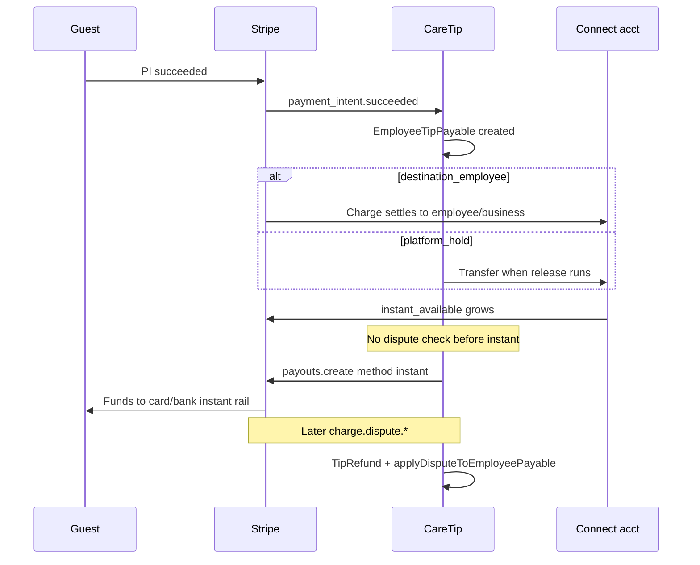

# CARETIP — Instant Payout × Stripe Dispute Interaction (Read-Only Audit)

**Date:** 2026-10-02  
**Mode:** Read-only — no code, Stripe, webhook, or ledger changes.  
**Related:** [CARETIP_LOST_DISPUTE_FINANCIAL_IMPACT_FORENSIC_AUDIT.md](./CARETIP_LOST_DISPUTE_FINANCIAL_IMPACT_FORENSIC_AUDIT.md)

---

## Executive answer

**Yes — tip-related funds can reach a connected account and be withdrawn via Instant Payout before a later dispute/chargeback.** CareTip does **not** reserve Connect balance against open or future disputes when evaluating Instant Payout. Eligibility is **Stripe-authoritative** (`balance.retrieve` with `instant_available`, payouts enabled, instant destination). The only CareTip gates on Instant Payout are **terms acceptance**, **idempotency**, **business soft-close / legal hold** (business path), **employee Connect readiness**, and **CareTip minimum amounts** — not `EmployeeTipPayable.disputedOpenCents` / `disputedLostCents`.

After a **lost** dispute, recovery depends on **charge model** and **timing**:

| Path | Can instant-pay before dispute? | CareTip recovery if lost after withdraw |
|------|----------------------------------|----------------------------------------|
| **destination_employee** | Yes (funds on employee Connect at charge) | **No** Transfer reversal; ledger `disputedLostCents` only |
| **platform_hold** → Transfer → Connect | Yes (after SCT; then `instant_available`) | **Attempt** `transfers.createReversal` on lost; **fails** if Connect balance already paid out (instant or standard) |
| **destination_business** | Yes (business Connect balance) | **No** employee/business Transfer reversal; distribution obligation reduced in CareTip ledger only |

**Stripe Connect defaults** in CareTip (`losses_collector: "application"` on business and employee account create) mean **platform-level loss collection is a Stripe responsibility setting**, not a CareTip per-payout block. Instant Payout does not implement an extra “clawback reserve.”

---

## 1. What Instant Payout is in CareTip

| Stakeholder | Service | API |
|-------------|---------|-----|
| **Employee** | `employeeInstantPayout.service.ts` | `GET/POST /api/me/employee-connect/instant-payout` |
| **Business (manager)** | `stripeConnectInstantPayout.service.ts` | `GET/POST /api/me/connect/instant-payout` |

**Not** CareTip SCT (`employeeTipRelease`), **not** scheduled business bank payouts (`businessBankPayoutSchedule`, `stripeConnectPayout.service` standard `method: standard`).

**Amount:** Payout uses **`snap.instantAvailableNetCents`** (full net instant pool Stripe reports), not a user-selected amount and **not** reduced by CareTip payable/dispute fields.

**Fee:** Documented as Stripe Platform Pricing on `instant_available.net_available`; CareTip does not apply a second 2.5% in code.

**Audit rows:** `EmployeeInstantPayoutRequest`, `StripeConnectInstantPayoutRequest` — request tracking + `stripePayoutId`; **no** link to `transactionId` / `EmployeeTipPayable`.

---

## 2. Eligibility flow (no dispute dimension)

`evaluateInstantPayoutForStripeAccount` (`stripeConnectInstantPayout.service.ts`):

1. Retrieve Connect **Account** (`payouts_enabled`, country).  
2. Retrieve **Balance** with `expand: ["instant_available.net_available"]`.  
3. List **external accounts** with `available_payout_methods` including `instant`.  
4. Eligible if `net > 0`, country supported, min thresholds (€0.40 Stripe EU min; **€30** employee floor in `EMPLOYEE_INSTANT_PAYOUT_MIN_CENTS`).

**Not consulted:**

- `EmployeeTipPayable` (`disputedOpenCents`, `disputedLostCents`, `remainingPayableCents`)  
- `TipRefund` / dispute webhooks  
- Per-tip attribution  
- Pending standard payouts schedule  

**Business-only CareTip blocks:** `deletedAt`, `legalHold` (`assertBusinessMayPayout`).

**Employee:** No equivalent “dispute hold” on instant payout; Connect status via `resolveActiveEmployeeForConnect`.

---

## 3. Tip money → Connect balance → Instant (timing)

### 3.1 When can Instant happen relative to the tip?

| Charge model | Funds on Connect | Typical Instant window |
|--------------|------------------|-------------------------|
| `destination_employee` | Immediately on successful charge (payable `destination_settled`, `transferredCents = payableCents`) | **As soon as** Stripe exposes `instant_available` for that balance |
| `platform_hold` | After `releaseHeldPlatformPayablesForEmployee` → Stripe Transfer | After release; **blocked** while `disputedOpenCents > 0` on that payable (release uses `remainingPayableCents`) |
| `destination_business` | Business Connect on charge | Business Instant can drain **business** Connect before off-platform employee distribution |

**Open dispute on platform_hold** prevents **new** Transfer of the disputed slice but does **not** claw back amounts already on Connect or already instant-paid.

---

## 4. Dispute webhooks (unchanged interaction with Instant)

**Handler:** `stripe.webhook.ts` → `upsertStripeDisputeEvent` → `applyDisputeToEmployeePayable`.

- **Reason** (e.g. `fraudulent`) is stored on `TipRefund`; **does not** affect Instant eligibility.  
- **Lost** on `platform_hold` after Transfer: `reverseReleasedEmployeeTransfer` (`employeeTipRelease.service.ts`).  
- **Reversal failure** (e.g. insufficient connected balance after Instant): `lastTransferError = "transfer_reversal_failed"`, `reversedCents` not increased — documented in `employee-tip-dispute-lifecycle-runtime.ts` (tests 10–11).

**Instant Payout is not triggered or reversed by dispute webhooks.** CareTip does not call Stripe to cancel a completed `Payout` when a dispute arrives.

---

## 5. Stripe Connect balances & negative balances

**CareTip does not:**

- Read or persist Connect **negative balance** state for Instant gating.  
- Implement reserve / rolling hold for dispute windows before Instant.  
- Reconcile `instant_available` against sum of undisputed payables.

**Stripe may:**

- Reduce `available` / `instant_available` when a dispute opens (issuer-dependent timing).  
- Reject Instant create with `balance_insufficient` (`mapInstantPayoutCreateError`).  
- Apply **negative connected balance** or platform debits per Connect rules and `losses_collector: "application"`.

That is **outside** CareTip’s instant eligibility code path except as Stripe API errors at request time.

---

## 6. Transfer reversals vs Instant Payout

| Mechanism | Scope | vs Instant |
|-----------|--------|------------|
| **Transfer reversal** | `platform_hold` only; lost dispute / refund on released Transfer | Pulls from **Connect balance**; fails if employee already **Instant- or bank-paid** out |
| **Instant Payout** | Full `instantAvailableNetCents` pool | Irreversible in CareTip; not tied to specific tips |
| **Destination charge lost dispute** | Ledger `disputedLostCents` | **No** CareTip reversal |

**Refund + lost dispute** on transferred hold: shared `reversedCents` budget (dispute lifecycle test 18) — still no link to Instant Payout records.

---

## 7. Standard bank payouts (contrast)

**Business / employee** scheduled or manual **standard** Connect payouts (`stripeConnectPayout.service.ts`, payout webhooks) also use Stripe **available** balance, not CareTip dispute netting. Same structural gap as Instant: faster liquidity via Instant, same lack of per-tip dispute reserve in CareTip.

---

## 8. Protections that **do** exist today

| Protection | Applies to Instant? | Notes |
|------------|---------------------|--------|
| Business **legal hold** | Yes (business) | Blocks Instant create |
| Business **soft delete** | Yes (business) | Blocks Instant |
| **Terms** acceptance | Yes | Audit log `instant_payout_terms_accepted` |
| **Idempotency** | Yes | Per-request ledger keys |
| **Open dispute** blocks platform-hold **Transfer** | Indirect | Stops *new* movement to Connect; not Instant on existing balance |
| **Lost dispute** Transfer reversal | platform_hold only | Best-effort; fails if balance gone |
| **Connect account mismatch** on dispute webhook | Dispute apply | Skips payable mutation (`skipped_mismatch`) |
| **Stripe** instant min/max, `balance_insufficient` | Yes | At API time |
| **losses_collector: application** (account defaults) | Stripe-side | Platform configured as losses collector; not a pre-withdrawal lock |

---

## 9. Protections that **do not** exist (gaps)

1. **No** reduction of Instant eligibility by `disputedOpenCents` / `disputedLostCents` or open `TipRefund` disputes.  
2. **No** FIFO / earmarking of Connect balance to undisputed tips.  
3. **No** delay or cooling period after tip before Instant on destination charges.  
4. **No** automatic recall of completed Instant Payouts when `charge.dispute.lost` fires.  
5. **No** CareTip enforcement when employee Instant withdraws **before** dispute on `destination_employee` (ledger-only adjustment).  
6. **Business Instant** can withdraw destination-charge tips **before** employee distribution or before dispute resolution.  
7. **Employee financial metrics** / dashboards do not block Instant (separate from eligibility API).

---

## 10. Scenario table (tip → Instant → lost dispute)

| # | Sequence | Employee Instant? | Business Instant? | If lost dispute later |
|---|----------|-------------------|-------------------|------------------------|
| 1 | Destination employee tip → Instant same day → dispute weeks later | **Yes** | N/A | Ledger lost cents; **no** CareTip reversal; Stripe/platform loss rules apply |
| 2 | Platform hold → release → Instant → lost | **Yes** | N/A | Reversal **attempt**; likely **fails** if Instant drained Connect |
| 3 | Platform hold → open dispute → Instant | **No new transfer**; existing Connect balance may still Instant | N/A | Open dispute blocked release, not necessarily instant pool |
| 4 | Business destination tip → business Instant | N/A | **Yes** | Obligation ↓ in CareTip; funds may already be off Connect |
| 5 | Dispute **before** payable row | N/A | N/A | Webhook may skip; backfill on tip success (`applyExistingStripeDisputeAfterSuccessfulTip`) — race separate from Instant |

---

## 11. Admin / operator visibility

- **Platform Connect activity** (`platformConnectActivity.service.ts`) classifies `instant_payout` vs `bank_payout` vs `caretip_transfer` — **no** dispute overlay on those rows.  
- **Refunds admin** shows dispute status/reason separately (semantics audit); not wired to Instant requests.

---

## 12. Verdict

**CareTip does not currently protect against an employee or business withdrawing Connect funds via Instant Payout that later become subject to a lost dispute**, beyond:

- indirect limits (platform-hold release freeze while disputed),  
- post-loss **Transfer reversal** on platform-hold (ineffective if funds already paid out),  
- Stripe’s own balance and Connect loss configuration, and  
- business legal hold.

Instant Payout and dispute handling operate on **different layers** (Stripe Connect balance vs `EmployeeTipPayable` / `TipRefund`). **Product/accounting policy** is required to decide whether to add reserves, delay instant eligibility, tie payouts to undisputed ledger totals, or accept platform/Stripe loss exposure — **not implemented in the current Instant Payout services.**

---

## 13. Key files

| Topic | Path |
|-------|------|
| Employee Instant | `backend/src/services/employeeInstantPayout.service.ts` |
| Business Instant + eligibility | `backend/src/services/stripeConnectInstantPayout.service.ts` |
| Employee min €30 | `backend/src/config/employeeInstantPayout.ts` |
| Terms gate | `backend/src/lib/instantPayoutTerms.ts` |
| Controllers | `employeeConnect.controller.ts`, `connect.controller.ts` |
| Platform hold release | `backend/src/services/employeeTipRelease.service.ts` |
| Dispute apply / reversal trigger | `backend/src/services/employeeTipPayable.service.ts` |
| Dispute webhooks | `backend/src/webhooks/stripe.webhook.ts`, `finance/tipRefunds.service.ts` |
| Connect loss defaults | `employeeStripeConnect.service.ts`, `stripeConnect.service.ts` (`losses_collector`) |
| Dispute + reversal tests | `backend/scripts/employee-tip-dispute-lifecycle-runtime.ts` |
| Instant tests (no dispute) | `backend/scripts/stripe-connect-instant-payout-runtime.ts`, `employee-instant-payout-runtime.ts` |

---

*End of read-only audit.*
