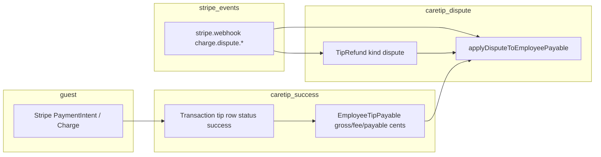

# CARETIP — Lost Stripe Dispute Financial Impact Forensic Audit

**Date:** 2026-10-01  
**Mode:** Read-only — no code, database, Stripe, webhook, or ledger changes.  
**Question:** When a tip payment becomes a **lost** Stripe dispute (e.g. reason `fraudulent`), what actually happens in CareTip’s money flow, and who bears the impact?

---

## Final verdict

**D. DISPUTE FINANCIAL HANDLING IS INCOMPLETE AND REQUIRES PRODUCT/ACCOUNTING DECISION**

CareTip **does** record disputes and **does** adjust `EmployeeTipPayable` exposure (open/lost cents, optional platform-hold Transfer reversal). That is **not** the same as a full, party-level accounting model for a €50 Stripe chargeback: gross tip and platform-fee fields stay frozen, `tips` success rows are unchanged, several dashboards still count gross/earnings without subtracting lost exposure, and **dispute reason (`fraudulent`) does not branch financial logic** — only Stripe **status/outcome** does. Stripe’s actual balance movements (platform vs connected account) are only partially mirrored in CareTip.

Sub-themes (not separate verdicts):

- **B** applies to analytics/dashboards (`tips` gross, `employeeEarningsEur`, business fees) vs payable ledger.
- **C** is **partially mitigated** for refund+dispute on platform-hold (`reversedCents` sharing; runtime tests in `employee-tip-dispute-lifecycle-runtime.ts`), but **presentation/metrics** can still misread state (e.g. lost dispute without open cents).

---

## 1. Concrete example — €50 tip (CareTip ledger math)

Authoritative fee rule: `backend/src/config/fees.ts` → `calculateTipPlatformFeeCents`.

| Field | Cents | EUR |
|--------|------:|-----|
| Customer gross (`grossCents`) | 5 000 | €50.00 |
| CareTip platform fee (`platformFeeCents`) | 549 | €5.49 (10% floor + €0.49) |
| Employee payable (`payableCents`) | 4 451 | €44.51 |

Created in `createEmployeeTipPayableForSuccessfulTip` (`employeeTipPayable.service.ts`) when the tip payment succeeds (`stripe.service.ts`).

**Stripe dispute object** typically carries `amount` = **full charge** (5 000 cents), independent of CareTip’s net split.

**CareTip dispute exposure** (`employeeDisputeExposureCents`):  
`min(disputeAmountCents, payableCents - refundedCents)` → for a full €50 dispute with no refund: **min(5000, 4451) = 4451** cents recorded in `disputedOpenCents` / `disputedLostCents`, **not** 5000.

**Implication:** The €5.49 platform fee is **not** represented as a separate disputed/lost line on `EmployeeTipPayable`. There is **no** CareTip table that records “platform absorbed €5.49 on lost dispute.” Whether Stripe/clawback affects the application fee is a **Stripe Connect settlement** question, not fully modeled in CareTip.

**`fraudulent` vs `lost`:**  
- Stored on `tip_refunds.reason` from Stripe (`upsertStripeDisputeEvent`).  
- **Never** read in `applyDisputeToEmployeePayable` — only `stripeStatus` → open / won / lost (`employeeDisputePhaseFromStripeStatus`).

---

## 2. End-to-end flow (original tip → dispute)

### 2.1 Customer payment → tip record

| Step | Authority | Notes |
|------|-----------|--------|
| Checkout / PI | `stripe.service.ts`, `employeeTipRouting.service.ts` | Charge model: `destination_employee`, `destination_business`, or `platform_hold`. |
| Tip row | `Transaction` (+ `tips` view) | `TipStatus.success`; **not** updated on dispute in traced code. |
| Payable | `EmployeeTipPayable` | One row per `transactionId`; integer cents. |

### 2.2 CareTip fee

- Frozen at creation: `platformFeeCents` on payable.  
- Destination charges use Stripe `application_fee_amount` at PI creation (`stripe.service.ts`).  
- **No** service reduces `platformFeeCents` or writes a fee-reversal row on dispute loss.

### 2.3 Employee transfer / business distribution

| Charge model | Routing | Initial payable status | Money movement (high level) |
|--------------|---------|------------------------|-----------------------------|
| `destination_employee` | `direct_to_employee` | `destination_settled`, `transferredCents = payableCents` | Charge settles to **employee** Connect; app fee to platform. |
| `destination_business` | `business_distribution` | `held_business` | Charge settles to **business** Connect; employee obligation is off-platform distribution (`tipDistribution.service.ts`). |
| `platform_hold` | either | `held_platform` | Charge on **platform**; later `employeeTipRelease.service.ts` Transfer to employee Connect. |

### 2.4 Stripe dispute webhooks

**Handler:** `backend/src/webhooks/stripe.webhook.ts`  
**Events:** `charge.dispute.created`, `charge.dispute.updated`, `charge.dispute.closed`  
**Fields passed:** `dispute.id`, `charge`, `payment_intent`, `amount`, `currency`, `status`, `reason`, `created`; `event.account` → `stripeEventAccount`.

**Service chain:**

1. `upsertStripeDisputeEvent` (`finance/tipRefunds.service.ts`)  
   - Upserts `TipRefund` (`kind: dispute`, status mapped via `mapStripeDisputeStatus`).  
   - `mergeDisputeLedgerStatus` prevents terminal won/lost from being downgraded by later non-terminal events.  
2. `applyDisputeToEmployeePayable` (`employeeTipPayable.service.ts`) if `tipId` resolved from charge/PI.

**Linking tip → business:** `resolveBusinessFromPaymentIntent` / `resolveBusinessFromChargeId` via `EmployeeTipPayable.stripeChargeId` / PI.

**Race:** If dispute webhook runs before payable exists, upsert may **skip** (no business link). `applyExistingStripeDisputeAfterSuccessfulTip` re-fetches Charge after successful tip write (`stripe.service.ts`).

**Idempotency:** `stripeWebhookEvent` per `event.id` (duplicate **event ids** not reprocessed). Same `stripeDisputeId` upserts one `TipRefund` row; payable apply uses same dispute id (duplicate created events do not double open exposure — tested).

**Refunds vs disputes:** `charge.refunded` / `refund.updated` → `upsertStripeRefundEvent` → `applyRefundToEmployeePayable` on succeeded refund. Separate from dispute path; refund cap respects `disputedLostCents` (`refundCap = payableCents - disputedLostCents`).

---

## 3. What `applyDisputeToEmployeePayable` does (financial semantics)

**File:** `backend/src/services/employeeTipPayable.service.ts`

| Stripe phase | `disputedOpenCents` | `disputedLostCents` | Transfer reversal |
|--------------|----------------------|----------------------|-------------------|
| Open (`needs_response`, etc.) | `exposure` | unchanged | No |
| Won | 0 | 0 | No |
| Lost | 0 | `exposure` | **Only** if `chargeModel === platform_hold` and lost: reverse up to `min(transferredCents, refundedCents + nextLost)` via `reverseReleasedEmployeeTransfer` |

**Exposure cap:** Employee **net payable** room only (see §1).

**Connect account guard:** If `event.account` ≠ payable `stripeDestinationAccountId`, apply is **skipped** (`skipped_mismatch`) — payable unchanged.

**Status field:** Payable `status` is **not** set to a dedicated “disputed” enum on loss; loss is carried in `disputedLostCents` (+ optional `reversedCents`).

**Original tip:** `Transaction` / payable row **retained** for audit; amounts on payable are cumulative counters, not deleted.

---

## 4. Scenario matrix — €50 / fraudulent reason / lost outcome

**Legend**

- **Emp payable:** `remainingPayableCents`, `netTransferredCents`, `disputedLostCents` on `EmployeeTipPayable`.  
- **Business:** `held_business` + `remainingDistributableCents` in `tipDistribution.service.ts` (uses `remainingPayableCents`).  
- **Platform:** Stripe balance + application fee; **no** CareTip platform-loss ledger.  
- **Reason `fraudulent`:** Same as any other reason in code.

Assume **full** €50 Stripe dispute amount unless noted. CareTip **lost exposure** ≈ **€44.51** on employee payable.

### 4.1 `platform_hold` + `direct_to_employee` (most documented in tests)

| Scenario | Employee payable | Business balance | Platform (CareTip ledger) | Reversal ledger | Fee reversed? | Double-charge risk |
|----------|------------------|------------------|---------------------------|-----------------|---------------|-------------------|
| **A. Before Transfer** | `disputedLostCents=4451`, `remainingPayable=0` | N/A (direct) | Hold not released; no Transfer | No | No | Low — duplicate dispute id tested |
| **B. Transfer created** (`transferring`) | Open dispute blocks release (`remainingPayable=0` while open) | N/A | Transfer not completed for disputed slice | No until lost | No | Race: release+dispute serialized (test 17) |
| **C. After Transfer succeeds** | Lost: `disputedLostCents=4451`, `reversedCents` up to 4451 if reversal OK | N/A | Attempts **Transfer reversal** to platform | `reversedCents` on payable | No | Refund+lost shares `reversedCents` (test 18) |
| **D. On employee Connect balance** | Same as C if reversal succeeded; if reversal fails: `lastTransferError=transfer_reversal_failed`, `reversedCents` **not** incremented | N/A | CareTip does not track Connect balance; reversal is best-effort | Partial | No | Employee may retain Connect funds if reversal fails |
| **E. After employee bank payout** | No separate CareTip state for bank payout; reversal may fail (test 10–11) | N/A | Stripe-side recovery only | Same as D | No | **Gap:** ledger may show lost exposure while funds left Connect |
| **F. Business distribution** | N/A if direct routing | — | — | — | — | — |
| **G. Business bank payout** | N/A | — | — | — | — | — |

### 4.2 `destination_employee` (direct Connect charge)

| Scenario | Employee payable | Business | Platform | Reversal in CareTip |
|----------|------------------|----------|----------|---------------------|
| **A–E (any timing)** | Lost: `disputedLostCents=4451`; `netTransferredCents` → 0 in summaries | Not in distribution ledger | App fee taken at charge | **No** Transfer reversal (`destReversals === 0` in tests) |
| **Stripe reality** | Connected account debited by Stripe on lost dispute | — | Platform fee treatment per Stripe Connect | CareTip does not claw back via SCT |

### 4.3 `destination_business` + `business_distribution`

| Scenario | Employee payable | Business obligation | CareTip Stripe actions |
|----------|------------------|---------------------|-------------------------|
| **Open dispute** | `disputedOpenCents=4451`, `remainingPayable=0` | Distributable obligation reduced via `remainingPayableCents` | No Transfer / reversal (tests 19b) |
| **Lost dispute** | `disputedLostCents=4451` | Same — less to distribute | No employee/business Transfer reversal (test 19) |
| **F. After distribution batch** | Allocations in `EmployeeTipDistributionAllocation`; integrity uses `remainingPayableCents` — **over-distribution** possible if batch completed before dispute (product edge) | Batch is immutable | No automatic clawback from batch |
| **G. Business payout** | Not modeled | Business Connect balance not adjusted in CareTip DB | Stripe handles connected balance |

---

## 5. Source of truth (tables / models)

| Concept | Authoritative store | Notes |
|---------|---------------------|--------|
| Gross tip (customer) | `Transaction.amount` / `tips` (`status=success`) | **Not** reduced on dispute |
| CareTip fee | `EmployeeTipPayable.platformFeeCents` | Frozen; not reversed on dispute |
| Employee entitlement | `EmployeeTipPayable.payableCents` minus `refundedCents`, `disputedOpenCents`, `disputedLostCents`, transfer counters | `remainingPayableCents`, `netTransferredCents` helpers |
| Dispute admin record | `TipRefund` (`stripeDisputeId`, `kind=dispute`, `status`, `reason`) | Independent of employee counters but drives apply via webhook |
| Refund admin record | `TipRefund` (`stripeRefundId`, `kind=refund`) | Drives `refundedCents` |
| Business distribute obligation | `EmployeeTipPayable` + allocations | `tipDistribution.service.ts` |
| Employee Transfer | `stripeTransferId`, `transferredCents`, `reversedCents` | Platform-hold only |
| Stripe bank payout | Connect payout objects | Observed in payout services; **not** dispute-adjusted in payable |
| Platform P&L / loss | **No dedicated model** | — |

---

## 6. Double counting / duplicate webhooks

| Risk | Mitigation in code | Residual |
|------|-------------------|----------|
| Duplicate `charge.dispute.created` same id | Single `TipRefund` row; exposure not double-opened (test 14) | — |
| Out-of-order won then open | Terminal won preserved on payable + `mergeDisputeLedgerStatus` (test 16) | — |
| Refund then lost dispute on transferred hold | Shared `reversedCents` budget (test 18) | Must not refund **and** dispute for overlapping cents without cap — refund cap uses `disputedLostCents` |
| Stripe €50 clawback + CareTip €44.51 lost cents | Different amounts by design | **Not** double on same cent field; **is** a **gross vs net** reconciliation gap with Stripe |
| Employee + business both charged in CareTip | Business lost: no employee reversal; direct employee: no business ledger charge | Stripe may still debit connected account once |
| Webhook retry new `event.id` | Re-runs upsert + apply; same dispute id → idempotent fields | Mismatch skip leaves payable stale |
| Dispute before payable exists | Event marked processed; backfill on tip success | If backfill fails, payable never adjusted |

---

## 7. Admin UI semantics (current)

**Refunds page** (post semantics pass): **Type** (Refund / Dispute), **Status** (e.g. Succeeded / Lost), **Reason** (e.g. Fraudulent) — separate badges; `fraudulentHint` clarifies Stripe category.  
**Does not** imply “lost because of fraud.”

**Platform admin** dispute row amount: `TipRefund.amountEur` (Stripe dispute amount, often gross €50), not necessarily equal to `disputedLostCents` on payable.

---

## 8. Employee dashboard

| Surface | Uses dispute loss? | Behavior |
|---------|-------------------|----------|
| `loadEmployeeFinancialMetrics` | **Partial** | `paidToStripeEur` uses `netTransferredCents` (subtracts open/lost). **`employeeEarningsEur` uses `payableCents - refundedCents` only** — does **not** subtract `disputedLostCents`. |
| `grossTipsEur` | **No** | `SUM(tips)` where `status=success`. |
| Payable activity list | **Yes** | Exposes `disputedOpenCents`, `disputedLostCents`, `remainingPayableCents`; `activityCents` uses `netTransferredCents` when transferred. |
| Presentation kind | **Partial** | `employeePayablePresentationKind` / `employeePayoutActivityKind`: **“disputed” only when `disputedOpenCents > 0`**. **Lost** dispute (open=0, lost>0) may still show as **transferred** / **destination_routed**. |
| Issues filter | Open disputes only | `disputedOpenCents > 0`; lost-only rows not in “issues”. |

---

## 9. Business dashboard

| Surface | Uses dispute loss? | Behavior |
|---------|-------------------|----------|
| `loadBusinessFinancialMetrics` | **No** on gross | `totalCustomerTipsEur` from successful `tips`; fees sum `platformFeeCents` on payables unchanged. |
| Distribution obligation | **Yes** | `remainingPayableCents` includes dispute deductions; `businessDistributionRemainingObligationForBusiness`. |
| `businessDistributionIntegrity` / held business | **Yes** | Rows include `disputedOpenCents` / `disputedLostCents` in obligation math. |
| Analytics charts (tip volume) | **Typically no** | Driven by successful transactions, not dispute-adjusted in traced SQL. |

---

## 10. Accounting concepts present vs missing

| Concept | Present? | Where |
|---------|----------|--------|
| Dispute open / lost exposure | Yes | `disputedOpenCents`, `disputedLostCents` |
| Refund | Yes | `refundedCents`, `TipRefund` refund kind |
| Transfer reversal | Yes | `reversedCents`, `reverseReleasedEmployeeTransfer` (platform-hold) |
| Chargeback / dispute admin | Yes | `TipRefund` dispute kind |
| Negative employee payable | No | Counters floored at 0; no negative balances |
| Business debit ledger | No | Obligation reduced; no Stripe clawback orchestration |
| Platform loss / fee clawback | No | No row when dispute > net payable |
| Policy by dispute reason | No | Reason stored only |

---

## 11. What is already correct (implementation intent)

- Dispute **reason** and **outcome** stored independently (`TipRefund.reason` vs `status`).  
- Employee payable dispute math documented and covered by `backend/scripts/employee-tip-dispute-lifecycle-runtime.ts`.  
- Platform-hold **lost** disputes attempt Transfer reversal; failed reversal does not fake `reversedCents`.  
- Destination and business-distribution paths **do not** incorrectly run employee Transfer reversals.  
- Refund and dispute lost share reversal budget on platform-hold to avoid double reverse.  
- Admin refunds UI separates type / status / reason (see `CARETIP_ADMIN_KYC_REFUND_SEMANTICS_AUDIT.md`).

---

## 12. What is missing / needs product or accounting decision

1. **Who absorbs the €5.49** (and any Stripe gross-vs-net gap) on a lost €50 dispute — platform vs business vs employee — when Connect settlement does not match `disputedLostCents`.  
2. Whether **gross tip analytics** and **employee earnings** should subtract lost exposure (ledger already does for release/distribution).  
3. **Destination-charge** lost disputes: CareTip marks `disputedLostCents` but does not orchestrate recovery from employee/business Connect — rely on Stripe only?  
4. **Post-distribution** disputes when business already paid employees off-platform.  
5. **Employee UI** labeling for **lost** disputes (not only open).  
6. Explicit **platform revenue reversal** tied to `platformFeeCents` on loss.  
7. Whether `Transaction` / tip **status** should reflect chargeback for reporting.

---

## 13. Summary table (requested format)

| Scenario | Employee impact | Business impact | Platform impact | Current CareTip behavior | Correctness / risk |
|----------|-----------------|-----------------|-----------------|--------------------------|-------------------|
| Lost dispute, hold, before transfer | Net €44.51 not releasable | — | Holds gross; fee not reversed in DB | `disputedLostCents`, `remaining=0` | Ledger consistent; analytics may overstate earnings |
| Lost dispute, hold, after transfer | Exposure + reversal attempt | — | Transfer reversal to platform | `reversedCents` if reversal succeeds | **Risk** if reversal fails but lost cents set |
| Lost dispute, destination employee | `disputedLostCents`; net settled → 0 in summary | — | Fee on payable unchanged | No CareTip reversal | **Stripe** bears connected debit; CareTip ledger ≠ Stripe cash |
| Lost dispute, business receives | Obligation −€44.51 | Distributable ↓; Connect funds Stripe-side | Fee unchanged | No Transfer/reversal | Business may still hold Connect balance; obligation reduced |
| Reason fraudulent | Same as any reason | Same | Same | Reason in `TipRefund` only | **Correct** not to equate fraudulent→lost |
| Refund + lost dispute (hold) | Shared reversal cap | — | Single reversal path | Test 18 | **Mitigated** double reverse |
| Duplicate webhooks | Idempotent exposure | — | — | Tests 14–15 | Low for same dispute id |
| Dispute before payable row | None until backfill | — | — | Skip + `applyExistingStripeDisputeAfterSuccessfulTip` | **Risk** if backfill never runs |
| Dashboard gross tips | Still €50 success | Still in tip totals | Fees still counted | No tip row change | **B** — metrics vs ledger |
| Dashboard employee earnings | May still show full net | — | — | Ignores `disputedLostCents` | **Misleading** vs `paidToStripeEur` |

---

## 14. Key files (trace index)

| Area | Path |
|------|------|
| Webhooks | `backend/src/webhooks/stripe.webhook.ts` |
| Dispute/refund ledger | `backend/src/services/finance/tipRefunds.service.ts` |
| Payable apply | `backend/src/services/employeeTipPayable.service.ts` |
| Payable create | `createEmployeeTipPayableForSuccessfulTip` |
| Tip success | `backend/src/services/stripe.service.ts` |
| Release / reversal | `backend/src/services/employeeTipRelease.service.ts` |
| Distribution | `backend/src/services/tipDistribution.service.ts` |
| Employee metrics | `backend/src/services/employeeFinancialMetrics.service.ts` |
| Business metrics | `backend/src/services/businessFinancialMetrics.service.ts` |
| Schema | `EmployeeTipPayable`, `TipRefund` in `backend/prisma/schema.prisma` |
| Regression tests | `backend/scripts/employee-tip-dispute-lifecycle-runtime.ts` |
| Admin UI | `src/app/pages/platform/revenue/PlatformRefundsPage.tsx`, `src/app/lib/platformRefundSemantics.ts` |
| Employee UI | `employeePayoutActivityPresentation.ts`, `employeePayableActivityPresentation.ts` |

---

*End of read-only audit.*
