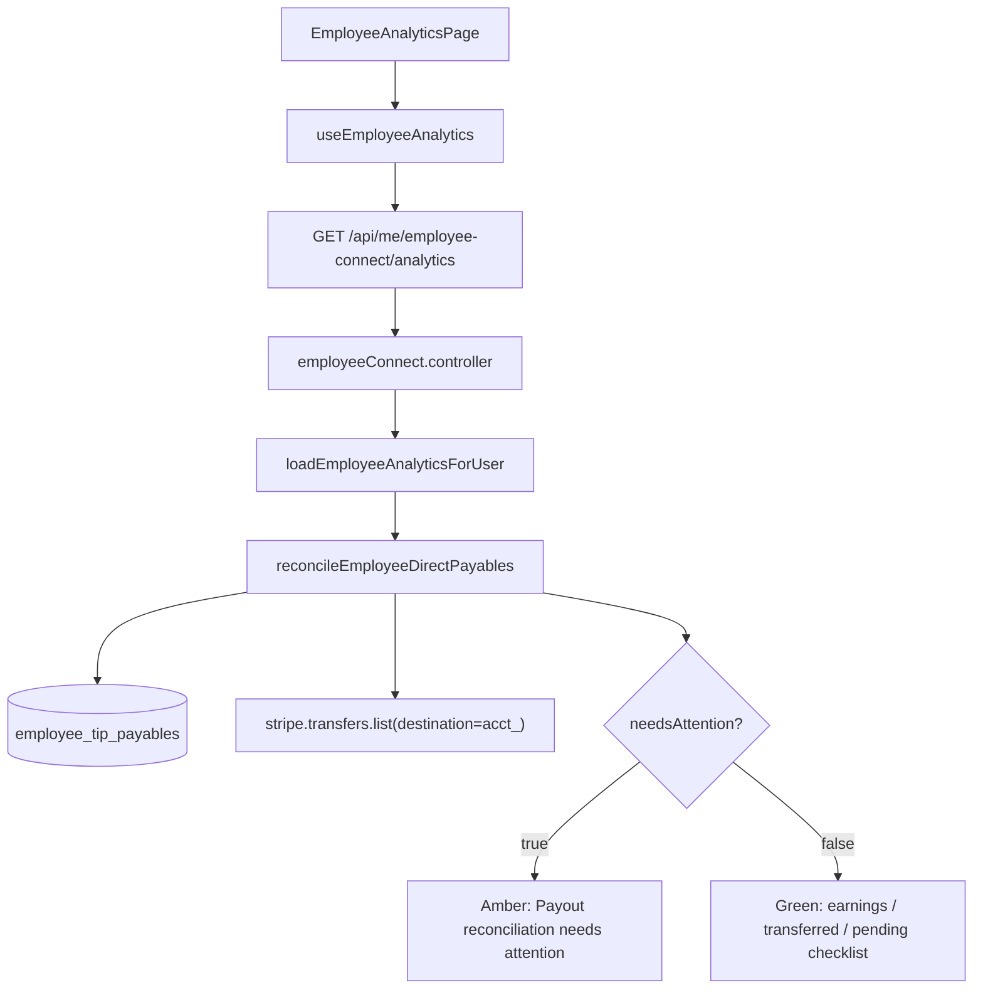

# Employee Payout Reconciliation UX Audit

**Date:** 2026-09-24  
**Scope:** Read-only forensic audit of the employee-facing warning  
**"Reconciliation status" → "Payout reconciliation needs attention"**  
**No code, financial records, or Stripe state was modified.**

---

## Executive summary

| Question | Answer |
|----------|--------|
| **Where is the warning shown?** | Web **Employee Analytics** page (`/employee/analytics`), not the main Employee Dashboard (`/employee/dashboard`). Mobile app has no equivalent warning today. |
| **What triggers it?** | `reconciliation.needsAttention === true` on `GET /api/me/employee-connect/analytics`. |
| **What is reconciled?** | **A only:** `EmployeeTipPayable` (routing `direct_to_employee`) vs Stripe **Transfers** (`stripe.transfers.list`). **Not** Stripe bank Payouts. |
| **Stripe object** | `Transfer` (`tr_…`), listed by Connect account `destination`. |
| **Is money at risk (current env)?** | **No** for the observed test accounts. Warning is driven by **insufficient Stripe verification** (`stripeReadable: false`) against seeded `destination_settled` payables without stored `stripeTransferId`. |
| **Eventual consistency vs genuine discrepancy?** | Current screenshot scenario is **informational / insufficient verification**, not a confirmed financial failure. Genuine mismatch classes exist in code but are not what the live test data shows. |

---

## 1. Current warning source

### Frontend component

| Layer | Location |
|-------|----------|
| **Page** | `src/app/pages/employee/EmployeeAnalyticsPage.tsx` |
| **Section** | Bottom block: `employee-analytics-status` (aria: `employee.analytics.statusAria`) |
| **Heading** | `employee.analytics.statusTitle` → **"Reconciliation status"** |
| **Warning title** | `employee.analytics.reconciliationAttention` → **"Payout reconciliation needs attention"** |
| **Warning hint** | `employee.analytics.reconciliationAttentionHint` → **"CareTip records and Stripe records are temporarily different."** |
| **Condition** | `data?.reconciliation.needsAttention` (boolean only; row-level detail is **not** rendered) |

```485:494:src/app/pages/employee/EmployeeAnalyticsPage.tsx
        <section className="employee-analytics-status" aria-label={t("employee.analytics.statusAria")}>
          <h2 className="employee-analytics-section-title">{t("employee.analytics.statusTitle")}</h2>
          {data?.reconciliation.needsAttention ? (
            <div className="flex items-start gap-2 rounded-lg border border-amber-500/30 bg-amber-500/5 px-4 py-3 text-sm">
              <AlertTriangle className="mt-0.5 h-4 w-4 shrink-0 text-amber-600" aria-hidden />
              <div>
                <p className="font-medium">{t("employee.analytics.reconciliationAttention")}</p>
                <p className="text-muted-foreground">{t("employee.analytics.reconciliationAttentionHint")}</p>
              </div>
            </div>
```

### Data hook → API

```
EmployeeAnalyticsPage
  → useEmployeeAnalytics(enabled, period)
    → getEmployeeAnalytics(period)
      → GET /api/me/employee-connect/analytics?period=…
```

| Layer | File |
|-------|------|
| Hook | `src/app/hooks/useEmployeeAnalytics.ts` |
| API client | `src/app/lib/api.ts` (`getEmployeeAnalytics`) |
| Route | `backend/src/routes/employeeConnect.routes.ts` → `GET /employee-connect/analytics` |
| Controller | `backend/src/controllers/employeeConnect.controller.ts` → `getMyEmployeeAnalytics` |
| Bundle loader | `backend/src/services/employeeAnalytics.service.ts` → `loadEmployeeAnalyticsForUser` |
| Reconciliation | `backend/src/services/employeePayoutReconciliation.service.ts` → `reconcileEmployeeDirectPayables` |

### Exact boolean

```178:183:backend/src/services/employeePayoutReconciliation.service.ts
  const needsAttention = rows.some((r) =>
    r.status === "STRIPE_TRANSFER_FOUND" ||
    r.status === "AMOUNT_MISMATCH" ||
    r.status === "DESTINATION_MISMATCH" ||
    r.status === "DUPLICATE_TRANSFER",
  );
```

**Does NOT trigger on:** `MATCHED`, `CARETIP_PENDING` (includes `transfer_failed`, `held_platform`, `transferring`).

---

## 2. Exact reconciliation flow

### CareTip side (authoritative ledger inputs)

For each employee, up to **100 most recent** payables where `routingMode = direct_to_employee`:

| Field | Use |
|-------|-----|
| `payableCents`, `transferredCents`, refund/dispute counters | Amount comparison |
| `status` | Routing state (`transferred`, `destination_settled`, `transfer_failed`, etc.) |
| `stripeTransferId` | Primary link to Stripe Transfer |
| `stripeDestinationAccountId` | Expected Connect destination |

Loaded from `employee_tip_payables` via Prisma in `reconcileEmployeeDirectPayables`.

### Stripe side

When employee has `employee_stripe_accounts.stripeAccountId` starting with `acct_` **and** `STRIPE_SECRET_KEY` is set:

```156:159:backend/src/services/employeePayoutReconciliation.service.ts
        : await getStripeClient().transfers.list({
            destination: employeeStripeAccountId,
            limit: 100,
          });
```

- **Object:** Stripe **Transfer** (`tr_…`)
- **Not used:** Payout (`po_…`), Charge, PaymentIntent, Balance (balance is shown separately in analytics `stripe` block)
- Transfers indexed by `id` and by metadata `caretip_payable_id`

### Matching logic (`classifyPayableRow`)

1. Find linked transfer: `stripeTransferId` → Stripe list, else single metadata match on `caretip_payable_id`
2. **>1 metadata match** → `DUPLICATE_TRANSFER`
3. **No linked transfer** and CareTip shows transfer activity (`status === transferred` OR `transferredCents > 0`) → `STRIPE_TRANSFER_FOUND` ⚠️ *misnamed — means Stripe transfer **not found***
4. **No linked transfer** and no transfer activity → `CARETIP_PENDING`
5. With linked transfer:
   - Destination ≠ employee Connect account → `DESTINATION_MISMATCH`
   - `linked.amount !== transferredCents` (when `transferredCents > 0`) → `AMOUNT_MISMATCH`
   - Otherwise → `MATCHED`

### Answer: Transfer vs bank Payout

| Comparison | Used for `needsAttention`? |
|------------|---------------------------|
| **A. EmployeeTipPayable ↔ Stripe Transfer** | **Yes** |
| **B. CareTip earnings ↔ Stripe bank Payout** | **No** (bank payouts are display-only in `stripe.bankPayouts`) |
| **C. Both** | **No** — only A drives the warning |

---

## 3. Stripe object(s) involved

| Object | Role |
|--------|------|
| **Transfer** (`tr_…`) | Sole reconciliation object for `needsAttention` |
| **Connect account** (`acct_…`) | Transfer `destination`; employee account from `EmployeeStripeAccount` |
| **Payout** (`po_…`) | Shown in "Bank payouts" table only; **not** part of reconciliation classifier |
| **Balance** | Shown in Stripe balance card (`stripe.availableCents` / `pendingCents`); **not** part of reconciliation |
| **Charge / PaymentIntent** | Not used in employee reconciliation (business reconciliation uses charges for `destination_settled` path) |

---

## 4. Exact reason the warning appears (current environment)

### Read-only DB inspection (2026-09-24)

Queried recent employees with `direct_to_employee` payables and ran `reconcileEmployeeDirectPayables` (no writes).

**Employees with `needsAttention: true`:**

| Employee | Email (test) | Payables | `stripeReadable` | Flagged status | Sample CareTip state |
|----------|--------------|----------|------------------|----------------|----------------------|
| EA TZ Emp | `ea-tz-emp-ea_tz_1790257697019@example.com` | 2 examined | **false** | `STRIPE_TRANSFER_FOUND` × 2 | `destination_settled`, €14.00 + €24.00 transferred, **no** `stripeTransferId` |
| EA KPI Emp | `ea-kpi-emp-ea_kpi_1790257501795@example.com` | 100 examined (105 total) | **false** | `STRIPE_TRANSFER_FOUND` × 100 | `destination_settled`, €9.00 each, **no** `stripeTransferId` |

**Root cause in this environment:**

1. Payables are marked **`destination_settled`** with **`transferredCents > 0`** (CareTip considers earnings routed to Connect).
2. Payables lack a persisted **`stripeTransferId`** and metadata cannot be matched.
3. **`stripeReadable: false`** — Stripe Transfer list was never loaded (`STRIPE_SECRET_KEY` missing/unusable, Connect account missing/invalid, or Stripe API error). With an empty transfer map, every “already transferred” payable classifies as `STRIPE_TRANSFER_FOUND`.
4. Employee UI collapses all of that into one alarming generic message.

This matches **intentionally incomplete analytics test fixtures** (EA timezone / KPI runtime seeds), not a verified production financial failure.

### Hypothetical production scenarios (from classifier + runtime test)

`backend/scripts/employee-payout-reconciliation-runtime.ts` documents real mismatch classes:

| Status | CareTip | Stripe Transfer | Classification |
|--------|---------|-----------------|----------------|
| `AMOUNT_MISMATCH` | `transferredCents: 3551` | `amount: 3000` | Amount mismatch |
| `DUPLICATE_TRANSFER` | One payable | Two transfers with same `caretip_payable_id` | Duplicate |
| `DESTINATION_MISMATCH` | Expected `acct_emp` | Transfer to different `destination` | Wrong account |
| `STRIPE_TRANSFER_FOUND` | `transferred` + ID | Transfer absent from list | Missing transfer evidence |

**Note:** `transfer_failed` payables classify as `CARETIP_PENDING` and **do not** trigger the warning — a significant UX gap if the intent is to surface failed releases.

---

## 5. Whether money is actually at risk

### Current test-data scenario

| Dimension | Assessment |
|-----------|------------|
| **Classification** | **1. Informational / insufficient verification** (closest fit). Could also be described as **2. Stripe synchronization delay** if Stripe were reachable but list lagged — not confirmed here because Stripe was unreadable. |
| **CareTip ledger** | Earnings recorded; payables `destination_settled` |
| **Stripe verification** | Not performed (`stripeReadable: false`) |
| **Employee action required** | **No** |
| **Funds presumed lost** | **No** — no evidence of missing transfers, only missing verification |

### Risk by status code (when Stripe **is** readable)

| Status | Money at risk? | Typical interpretation |
|--------|----------------|------------------------|
| `STRIPE_TRANSFER_FOUND` | **Maybe** — needs ops review; could be timing, pagination (only last 100 transfers), or missing transfer | Verify before alarming employee |
| `AMOUNT_MISMATCH` | **Possible discrepancy** — CareTip and Stripe amounts differ | Internal investigation |
| `DESTINATION_MISMATCH` | **Possible mis-routing** | Internal investigation |
| `DUPLICATE_TRANSFER` | **Possible double payment** | Internal investigation |
| `CARETIP_PENDING` | **No** for transferred path; pending release is normal | Not shown in warning today |
| `MATCHED` | **No** | Healthy |

**Do not** label a temporary CareTip/Stripe timing gap or unreadable Stripe as financial failure without row-level confirmation.

---

## 6. Eventual consistency vs genuine discrepancy

| Scenario | Type |
|----------|------|
| Current env (`stripeReadable: false`, test `destination_settled` seeds) | **Insufficient verification / test data artifact** — not a confirmed discrepancy |
| Transfer created seconds ago, not yet in `transfers.list` | **Eventual consistency** — should not use generic “needs attention” |
| CareTip `transferred` but no `tr_` after reasonable delay | **Transfer missing** — internal issue; employee copy should be calm and specific |
| Amount / destination / duplicate flags with readable Stripe | **Genuine discrepancy candidate** — employee should not see internal details; ops handles |

---

## 7. Current source-of-truth chain

### What employee reconciliation uses ✅

| Source | Role |
|--------|------|
| `EmployeeTipPayable` | Primary CareTip ledger row per tip |
| `payableCents`, `transferredCents`, frozen fee fields | Amount truth |
| Payable `status` + routing mode | Routing state |
| `stripeTransferId`, `stripeDestinationAccountId` | CareTip-side Stripe linkage |
| Stripe `transfers.list(destination=acct_…)` | External Transfer truth |

### What it does **not** use ✅

| Anti-pattern | Employee reconciliation |
|--------------|----------------------|
| `Transaction.payoutStatus` as financial SoT | **Not used** in reconciliation service |
| Client-derived financial status | **No** — server-side only |
| Hard-coded amounts | **No** |
| Legacy payout fields on Transaction | **Not used** for classifier |

### Related analytics data (same API bundle, separate concerns)

| Data | Service | SoT |
|------|---------|-----|
| Lifetime earnings / paid to Stripe / pending | `loadEmployeeFinancialMetrics` | `EmployeeTipPayable` aggregates |
| Stripe balance | `getEmployeeInstantPayoutEligibilityForStripeAccount` | Live Connect balance |
| Bank payouts table | `listEmployeeStripeBankPayoutsForUser` | Stripe `payouts.list` |
| Tip record `payoutStatus` label | `employeeAnalytics.service.ts` `payoutStatusLabel()` | **Presentation only**, derived from payable status |

### Architecture gap vs business remediation

Business reconciliation (`businessPayoutReconciliation.service.ts`) maps unreadable Stripe to **`INSUFFICIENT_VERIFICATION`** and does not treat missing transfer list as `STRIPE_TRANSFER_MISSING` when `!stripeReadable`.

**Employee reconciliation has no equivalent guard.** When Stripe cannot be read, transferred payables still become `STRIPE_TRANSFER_FOUND` → `needsAttention: true`. This is the primary false-positive path in dev/test.

Business layer also renames `STRIPE_TRANSFER_FOUND` → `STRIPE_TRANSFER_MISSING` for clarity. Employee API exposes the confusing raw name internally (not shown in UI today).

---

## 8. Recommended employee-facing states

The UI should **not** use one generic amber banner. Map server `reconciliation.rows` (and `stripeReadable`) to specific copy. Suggested states:

### When `!stripeReadable` and no confirmed mismatch

- **What happened?** We could not verify your Stripe transfers right now.
- **Is my money safe?** Your earnings remain recorded in CareTip.
- **Action required?** No.
- **What is being checked?** Transfer confirmation with Stripe.

**Suggested copy:**  
*"We couldn't verify your Stripe transfers at the moment. Your earnings are still recorded in CareTip. No action is needed."*

### `STRIPE_TRANSFER_FOUND` (Stripe readable — transfer not found)

**Suggested copy:**  
*"We're confirming a recent transfer to your Stripe account. Your earnings remain recorded in CareTip. No action is needed unless this message persists."*

### `AMOUNT_MISMATCH`

**Suggested copy:**  
*"We're reviewing a transfer amount with Stripe. Your earnings remain recorded in CareTip. Our team is looking into it — you don't need to do anything."*

### `DESTINATION_MISMATCH`

**Suggested copy:**  
*"We're verifying that a transfer reached the correct Stripe account. No action is needed from you."*

### `DUPLICATE_TRANSFER`

**Suggested copy:**  
*"We're reviewing a duplicate transfer record with Stripe. No action is needed from you."*

### `CARETIP_PENDING` / `transfer_failed` (not in `needsAttention` today — recommend separate surfacing)

For failed release (today hidden from this banner):

**Suggested copy:**  
*"A transfer to your Stripe account couldn't be completed. We're retrying automatically. Make sure your Stripe account is fully set up."*

### Healthy (`MATCHED`, no attention rows)

Keep existing green checklist (earnings / transferred / pending).

---

## 9. Recommended UI changes (implementation phase — not done in this audit)

1. **Replace boolean banner** with status-specific messaging driven by `reconciliation.rows` + `stripeReadable`.
2. **Do not show warning when `!stripeReadable`** unless product policy requires it — prefer neutral informational tone (align with business `INSUFFICIENT_VERIFICATION`).
3. **Rename internal status** `STRIPE_TRANSFER_FOUND` → `STRIPE_TRANSFER_MISSING` in employee API for parity with business layer.
4. **Surface counts, not IDs** — e.g. "2 earnings records are being verified" (never expose `tr_`, `payableId`, etc.).
5. **Pagination awareness** — if only 100 payables / 100 transfers examined, show completeness hint (business analytics already has `reconciliationIncomplete` pattern).
6. **Consider `transfer_failed`** — either include in `needsAttention` with distinct copy or separate "Pending release" callout (today fails silently in this section).
7. **Clarify page placement** — "Reconciliation status" refers to **Transfer** verification, not bank payout status; consider renaming section to avoid "payout" ambiguity.
8. **Mobile parity** — mobile has no reconciliation warning; decide if analytics mobile should match web.

---

## 10. Tests that should be added

| Test | Purpose |
|------|---------|
| `stripeReadable: false` + `destination_settled` payables | Assert **no** alarming `needsAttention` (or informational-only state) after UX fix |
| `stripeReadable: true` + matched transfer | Assert green path, `needsAttention: false` |
| Each attention status in isolation | Assert correct employee copy mapping (component/i18n tests) |
| `transfer_failed` payable | Assert employee-appropriate messaging (once product decides visibility) |
| >100 payables / >100 transfers | Assert truncation / incomplete messaging |
| E2E employee analytics | Mock API with `needsAttention` + row statuses; assert specific strings, not generic hint |
| Regression: `Transaction.payoutStatus` unused | Static/grep guard in reconciliation service tests |

Existing coverage: `backend/scripts/employee-payout-reconciliation-runtime.ts` (classifier only, no UI).

---

## 11. Genuine financial risks identified

| Risk | Severity | Notes |
|------|----------|-------|
| False positives when Stripe unreadable | **High UX / trust** | Confirmed in current env; employees may think earnings are unsafe |
| Misleading status name `STRIPE_TRANSFER_FOUND` | **Medium ops** | Opposite of actual meaning (transfer missing) |
| `transfer_failed` excluded from `needsAttention` | **Medium UX** | Failed releases don't surface in reconciliation section |
| 100-item cap on payables and transfers | **Low–medium** | Older mismatches may be invisible; banner may clear incorrectly |
| Single generic message for four distinct failure classes | **High UX** | Employees cannot tell timing vs failure vs ops issue |
| No row-level detail in UI | **Medium** | Backend has rich `reconciliation.rows`; frontend ignores it |

No evidence in the current environment of actual missing funds, amount errors, or destination errors — only **unverified** test ledger rows.

---

## Appendix A — End-to-end diagram



## Appendix B — i18n keys

| Key | EN value |
|-----|----------|
| `employee.analytics.statusTitle` | Reconciliation status |
| `employee.analytics.reconciliationAttention` | Payout reconciliation needs attention |
| `employee.analytics.reconciliationAttentionHint` | CareTip records and Stripe records are temporarily different. |

## Appendix C — API response shape (reconciliation slice)

```typescript
reconciliation: {
  rows: Array<{
    payableId: string;
    transactionId: string;
    status: "MATCHED" | "CARETIP_PENDING" | "STRIPE_TRANSFER_FOUND" |
            "AMOUNT_MISMATCH" | "DESTINATION_MISMATCH" | "DUPLICATE_TRANSFER";
    caretipPayableCents: number;
    caretipTransferredCents: number;
    caretipRemainingCents: number;
    caretipStatus: string;
    stripeTransferId: string | null;
    stripeTransferAmountCents: number | null;
    stripeDestination: string | null;
    employeeStripeAccountId: string | null;
  }>;
  needsAttention: boolean;
  stripeReadable: boolean;
}
```

---

**Report path:** `EMPLOYEE_PAYOUT_RECONCILIATION_UX_AUDIT.md`
